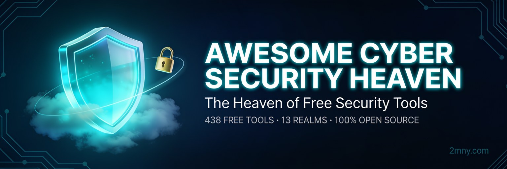

  

# 🛡️ Awesome Cyber Security Heaven ☁️🔐

> **The Ultimate Curated Arsenal — 100% Free & Open Source.** A hand-curated, license-aware map of the
> best free cybersecurity tools — from pentesting and bug bounty to OSINT, threat intel, DFIR,
> DevSecOps and AI/LLM security. Every entry earns its place. 🌟
> **2026 edition** — 444 tools, 14 realms, every link re-verified 2026-10-15. 📅

🧭 **444 curated tools** · 🏰 **14 themed realms** · 🗓️ **2026 edition** · 🆓 **100% free / free-tier** · 🔬 **license-verified** · 🔄 **actively maintained** · 💯 **no paywalls, no SaaS wrappers**

**Legend** — ⚖️ `(GPL-…)` / `(AGPL-…)` = copyleft license · 🎁 `(free tier)` / `(freemium)` = free tier of a
commercial service · 🔒 `(free, proprietary)` = freeware, not open source · 🏠 `(maintainer's project)` =
the curator's own tool, included transparently.

## 📖 Contents

- [⚔️ The Armory — Offensive Security, Pentesting & Bug Bounty Tools (42)](#️-the-armory--offensive-security-pentesting--bug-bounty-tools)
- [🛡️ The Bastion — Hardening & Defensive Infrastructure Tools (33)](#️-the-bastion--hardening--defensive-infrastructure-tools)
- [🔭 The Watchtower — Threat Intelligence Tools & Feeds (17)](#-the-watchtower--threat-intelligence-tools--feeds)
- [🗺️ The Cartographers — Recon, OSINT & Attack-Surface Mapping Tools (38)](#️-the-cartographers--recon-osint--attack-surface-mapping-tools)
- [🕵️ The Shadow Bureau — OSINT & Public-Intelligence Tools (29)](#️-the-shadow-bureau--osint--public-intelligence-tools)
- [🔑 The Vault — Secrets, Credentials & Password Security Tools (17)](#-the-vault--secrets-credentials--password-security-tools)
- [🐳 The Foundry — DevSecOps, Cloud & Container Security Tools (31)](#-the-foundry--devsecops-cloud--container-security-tools)
- [🔵 The Sentinel Ops — Blue Team, SOC & DFIR Tools (47)](#-the-sentinel-ops--blue-team-soc--dfir-tools)
- [🤖 The Oracle's Domain — AI Security & LLM Security Tools (6)](#-the-oracles-domain--ai-security--llm-security-tools)
- [🧠 The AI Forge — AI-Dependent Security Tools (10)](#-the-ai-forge--ai-dependent-security-tools)
- [🆓 The Free Bazaar — Free Cybersecurity APIs, Feeds & Data (30)](#-the-free-bazaar--free-cybersecurity-apis-feeds--data)
- [🎓 The Academy — Cybersecurity Learning Resources & Career Paths (24)](#-the-academy--cybersecurity-learning-resources--career-paths)
- [🎯 The Proving Grounds — CTF Practice, Labs & Hacking Training (74)](#-the-proving-grounds--ctf-practice-labs--hacking-training)
- [🧰 The Workshop — Utilities & Swiss-Army Tools (47)](#️-the-workshop--utilities--swiss-army-tools)

📂 **Realm dossiers:** every realm has a deep page with the full inventory, star counts, project
ages and last-push dates — see [`realms/`](realms/).

## 📄 Realm Dossiers — Deep-Research PDF Reports

Every realm ships as a designed, printable **PDF dossier** — dark-theme cover, numbered chapters,
running header & footer with page numbers, adoption charts (top-starred, most-forked, language mix,
creation eras), a license-mix donut, and a full-page dossier for every curated tool (live GitHub
census + **their claim vs our curator's note** + **who uses it & what it replaces** + signal checks).
Every figure pulled from the live GitHub API (census 2026-10-17). **528 pages across 14 dossiers** — free forever, CC0.

| Dossier | Focus | Pages |
|---|---|---:|
|  ⚔️ [The Armory](<pdfs/awesome-cyber-security-heaven-armory-offensive-security-pentesting-bug-bounty-tools.pdf>) | offensive security · pentesting · bug bounty | 48 |
|  🛡️ [The Bastion](<pdfs/awesome-cyber-security-heaven-bastion-hardening-defensive-infrastructure-tools.pdf>) | hardening · defensive infrastructure | 39 |
|  🔭 [The Watchtower](<pdfs/awesome-cyber-security-heaven-watchtower-threat-intelligence-tools-feeds.pdf>) | threat intelligence · feeds | 22 |
|  🗺️ [The Cartographers](<pdfs/awesome-cyber-security-heaven-cartographers-recon-osint-attack-surface-mapping-tools.pdf>) | recon · OSINT · attack-surface mapping | 44 |
|  🕵️ [The Shadow Bureau](<pdfs/awesome-cyber-security-heaven-shadow-bureau-osint-public-intelligence-tools.pdf>) | OSINT · public intelligence | 35 |
|  🔑 [The Vault](<pdfs/awesome-cyber-security-heaven-vault-secrets-credentials-password-security-tools.pdf>) | secrets · credentials · password security | 23 |
|  🐳 [The Foundry](<pdfs/awesome-cyber-security-heaven-foundry-devsecops-cloud-container-security-tools.pdf>) | DevSecOps · cloud · container security | 37 |
|  🔵 [The Sentinel Ops](<pdfs/awesome-cyber-security-heaven-sentinel-ops-blue-team-soc-dfir-tools.pdf>) | blue team · SOC · DFIR | 53 |
|  🤖 [The Oracle's Domain](<pdfs/awesome-cyber-security-heaven-oracles-ai-security-llm-security-tools.pdf>) | AI security · LLM security | 12 |
|  🧠 [The AI Forge](<pdfs/awesome-cyber-security-heaven-ai-forge-ai-dependent-security-tools.pdf>) | AI-dependent security tools | 16 |
|  🆓 [The Free Bazaar](<pdfs/awesome-cyber-security-heaven-free-bazaar-free-cybersecurity-apis-feeds-data.pdf>) | free cybersecurity APIs · feeds · data | 36 |
|  🎓 [The Academy](<pdfs/awesome-cyber-security-heaven-academy-cybersecurity-learning-resources-career-paths.pdf>) | learning resources · career paths | 30 |
|  🎯 [The Proving Grounds](<pdfs/awesome-cyber-security-heaven-proving-grounds-ctf-practice-labs-hacking-training.pdf>) | CTF practice · labs · hacking training | 80 |
|  🧰 [The Workshop](<pdfs/awesome-cyber-security-heaven-workshop-utilities-swiss-army-tools.pdf>) | utilities · swiss-army tools | 53 |

---

  

> ✨ **Featured Product 🏠 — [2MNY Website Vulnerability Scanner](https://github.com/RanaKhan77/Website-Vulnerability-Scanner)**
> 200 free, self-hosted protection modules — the same 200-module engine our own platform runs, finding SQLi, XSS, SSRF and injection risks with ownership-gated, evidence-backed testing.
> Run it yourself with one Docker command, or try it free online at **[2mny.com](https://2mny.com)**.

## ⚔️ The Armory — Offensive Security, Pentesting & Bug Bounty Tools
Intro: The professional offensive toolkit for authorized engagements, red-team exercises and training labs — the weapons every pentester reaches for first.

- [Metasploit Framework](https://github.com/rapid7/metasploit-framework) — the world's most-used pentest framework; thousands of validated modules for exploitation, post-engagement evidence gathering and reporting in authorized tests. Used by professional penetration testers and red teams in authorized engagements; the open-source counterpart to commercial exploitation platforms like Core Impact and Cobalt Strike.
- [Nmap](https://nmap.org) — the original network mapper: port, service and OS discovery plus the NSE scripting engine for everything from TLS audits to SMB checks. Used by virtually every network security auditor on earth; the open standard that commercial scanners built their discovery phases on.
- [Burp Suite Community Edition](https://portswigger.net/burp/communitydownload) — the industry-standard intercepting proxy for manual web testing; the free tier is where nearly every bug hunter starts. Used by web penetration testers as their daily intercepting proxy; the free tier of the industry-standard Burp Suite Professional. (free, proprietary)
- [Nuclei](https://github.com/projectdiscovery/nuclei) — template-driven vulnerability scanner; the huge community template corpus gives it detection breadth no single scanner matches. Used by bug bounty hunters and enterprise security teams alike for template-driven scanning at scale; a free staple that rivals paid web-scanning engines for public attack-surface checks.
- [OWASP ZAP](https://github.com/zaproxy/zaproxy) — the open-source intercepting proxy and scanner — a full free Burp alternative with CI/CD integration and a big add-on ecosystem. Used by web pentesters, QA teams and bug bounty beginners.
- [sqlmap](https://github.com/sqlmapproject/sqlmap) — the definitive SQL injection detection and exploitation tool for authorized web application testing. Used by penetration testers everywhere for SQL injection proof; the definitive free SQLi automation tool with no real commercial equal. (GPL-2.0)
- [Impacket](https://github.com/fortra/impacket) — the standard Python library for low-level Windows protocol work (SMB, LDAP, Kerberos); powers wmiexec/secretsdump-class tooling and AD assessments. Used by red teamers and AD security researchers; the Python underpinning of countless offensive and defensive toolkits.
- [MITRE Caldera](https://github.com/apache/caldera) — scalable adversary-emulation platform built on ATT&CK; run purple-team exercises that prove your detections actually fire. Used by red teams and purple teams for automated adversary emulation; the open-source alternative to commercial breach-attack-simulation platforms like AttackIQ and SafeBreach.
- [BloodHound](https://github.com/SpecterOps/BloodHound) — maps the shortest attack paths through Active Directory; defenders run it to find and fix their way to Domain Admin. Used by Active Directory pentesters to map hidden attack paths; the standard tool defenders also run to harden AD.
- [MobSF](https://github.com/MobSF/Mobile-Security-Framework-MobSF) — all-in-one mobile app security: static + dynamic analysis for Android/iOS in a single pipeline. Used by mobile app security testers for static and dynamic analysis; the open-source alternative to commercial mobile app testing suites. (GPL-3.0)
- [WPScan](https://github.com/wpscanteam/wpscan) — black-box WordPress scanner: plugin/theme enumeration and version-based vuln lookups. Used by WordPress security auditors and managed-service providers; the standard black-box WordPress scanner, free alternative to paid WP security suites. (free for non-commercial use)
- [Bettercap](https://github.com/bettercap/bettercap) — the Swiss-army knife for authorized network assessments: ARP/DNS spoofing, MITM proxies, WiFi and BLE modules. Used by network penetration testers for authorized MITM analysis; the modern successor to Ettercap in most toolkits. (GPL-3.0)
- [Nikto](https://github.com/sullo/nikto) — venerable web-server scanner; noisy but thorough on server misconfigurations and default files. Used by web server auditors for two decades; the venerable free complement to commercial web scanners' misconfiguration checks. (GPL-3.0; DB files have custom terms)
- [h5i](https://github.com/h5i-dev/h5i) — agent-native web-security workspace: deterministic recon, secrets scanning, DOM post-message auditing and CI regression checks — fully usable without any LLM key. Used by security engineers wanting agent-native, deterministic web checks; a newer open alternative to dashboard-driven commercial scanners. (Apache-2.0)
- [goshs](https://github.com/goshs-labs/goshs) — hardened HTTP file-transfer server built for engagements: upload/download, authentication, access control and TLS — the modern replacement for `python -m http.server`. Used by pentesters on engagements as a hardened file-transfer server; the security-hardened alternative to spinning up ad-hoc Python servers.
- [Dalfox](https://github.com/hahwul/dalfox) — fast XSS scanner with DOM-aware analysis and a strong payload set; the modern XSS go-to. Used by bug bounty hunters for fast, DOM-aware XSS scanning; a favorite free alternative to Burp's scanner for XSS-only sweeps.
- [NetExec](https://github.com/Pennyw0rth/NetExec) — CrackMapExec's actively maintained successor; audit credential hygiene and service misconfigurations across whole subnets. Used by internal network auditors and AD pentesters for credential-hygiene sweeps.
- [Responder](https://github.com/lgandx/Responder) — LLMNR/NBT-NS/MDNS poisoner; the fastest way to demonstrate credential-leak exposure on an authorized internal network. Used by internal penetration testers to demonstrate credential exposure on enterprise networks; the canonical LLMNR/NBT-NS poisoner. (GPL-3.0)
- [commix](https://github.com/commixproject/commix) — automated OS command injection detection and exploitation for web tests. Used by web pentesters for command-injection proof; a focused free tool that complements general-purpose commercial scanners. (GPL-3.0)
- [Ghauri](https://github.com/r0oth3x49/ghauri) — a strong sqlmap alternative for error/union/blind SQLi with clever parameter tampering; slower release cadence but unique value. Used by bug bounty hunters for tricky blind, error-based and time-based SQLi.
- [2mny Website Vulnerability Scanner](https://github.com/RanaKhan77/Website-Vulnerability-Scanner) — open-source web vulnerability scanner with 200 deterministic modules: OWASP Top 10, XSS/SQLi/SSRF, subdomain takeover, WordPress and AI/LLM surface checks, CVSS-scored evidence and HTML/PDF reports. Self-hosted via Docker. Used by security teams that want evidence-backed, deterministic scanning they can self-host; the open-source alternative to paid scanner SaaS for website attack surfaces. (maintainer's project)
- [masscan](https://github.com/robertdavidgraham/masscan) — the fastest TCP port scanner on earth; scan the whole internet in minutes — on networks you're authorized to test. Used by researchers and recon teams for internet-scale port discovery. (AGPL-3.0)
- [RustScan](https://github.com/bee-san/RustScan) — modern Rust port scanner that finds open ports in seconds and pipes them straight into Nmap. Used by bug bounty hunters and sysadmins for fast port discovery with Nmap piping; a modern free alternative to legacy scanners. (GPL-3.0)
- [Tsunami](https://github.com/google/tsunami-security-scanner) — Google's security scanner for large fleets, focused on reliably exploitable high-severity flaws with few false positives. Used by security teams scanning large fleets of internet-facing services; Google's open-source answer to commercial enterprise web scanners.
- [wafw00f](https://github.com/EnableSecurity/wafw00f) — fingerprints the web application firewall sitting in front of a site so you know exactly what you're testing against. Used by pentesters planning engagements to fingerprint WAFs first; the standard free WAF detector.
- [wapiti](https://github.com/wapiti-scanner/wapiti) — open-source black-box web vulnerability scanner that crawls and audits without needing a browser. Used by web pentesters and CI pipelines for black-box web scanning; a solid free alternative to paid web vulnerability scanners. (GPL-2.0)
- [WhatWeb](https://github.com/urbanadventurer/WhatWeb) — identifies what a website is built with — frameworks, CMSs, servers and versions — in one command. Used by recon teams to fingerprint what a site runs on; the standard free tech-identifier behind many commercial recon feeds. (GPL-2.0)
- [GitTools](https://github.com/internetwache/GitTools) — recovers an exposed `.git` directory into full source and commit history — audit your servers before attackers do. Used by bug bounty hunters to recover exposed .git directories into full source; the go-to free tool for this bug class.
- [tplmap](https://github.com/epinna/tplmap) — server-side template injection detection and exploitation across a dozen template engines; quiet upstream but still the SSTI reference. Used by pentesters for server-side template injection proof across a dozen engines; no commercial equivalent needed. (GPL-3.0)
- [JoomScan](https://github.com/OWASP/joomscan) — OWASP's Joomla scanner: vulnerable components and misconfigurations on Joomla sites; quiet upstream, still OWASP's reference. Used by pentesters auditing Joomla deployments; OWASP's free Joomla scanner. (GPL-3.0)
- [ACSTIS](https://github.com/tijme/angularjs-csti-scanner) — the classic AngularJS client-side template injection scanner — legacy framework, still found everywhere. Used by bug hunters verifying this niche on legacy apps. (unmaintained classic)
- [kiterunner](https://github.com/assetnote/kiterunner) — API route brute-forcer with method-aware wordlists derived from Swagger specs; dormant upstream, still the reference. Used by API security testers brute-forcing routes with method-aware wordlists; the open-source alternative to commercial API discovery scans. (AGPL-3.0)
- [osmedeus](https://github.com/j3ssie/osmedeus) — workflow engine that chains recon and scanning into scheduled, repeatable attack-surface pipelines. Used by recon teams automating full attack-surface workflows; the free alternative to commercial ASM platforms for scheduled recon.
- [ettercap](https://github.com/Ettercap/ettercap) — the veteran MITM analysis suite for ARP poisoning, sniffing and protocol dissection — bettercap's classic sibling. Used by network pentesters and students learning MITM analysis; the veteran suite that inspired later tools like Bettercap. (GPL-2.0)
- [OpenVAS Scanner](https://github.com/greenbone/openvas-scanner) — Greenbone's open-source vulnerability scanning engine for network and service flaws. Used by security teams running unauthenticated network vulnerability scans; the classic open-source alternative to Nessus, Qualys and Rapid7 InsightVM. (GPL-2.0)
- [aircrack-ng](https://github.com/aircrack-ng/aircrack-ng) — the complete WiFi security audit suite: capture, inject and audit — the wireless standard for two decades. Used by WiFi security auditors worldwide; the complete free suite replacing any commercial WiFi assessment tool. (GPL-2.0)
- [THC-Hydra](https://github.com/vanhauser-thc/thc-hydra) — the classic parallelized login cracker for 50+ protocols; password audits only on systems you own or are paid to test. Used by pentesters for authorized login audits across 50+ protocols; the classic parallelized cracker with no commercial equal. (AGPL-3.0)
- [objection](https://github.com/sensepost/objection) — Frida-powered runtime exploration toolkit for mobile apps — inspect and manipulate iOS/Android at runtime. Used by mobile pentesters for runtime exploration without jailbreaks; the go-to Frida front-end for mobile engagements. (GPL-3.0)
- [RsaCtfTool](https://github.com/Ganapati/RsaCtfTool) — RSA security-testing tool: attacks weak keys and unprotected disclosures purely offline, for auditors and CTF practice. Used by CTF players and crypto researchers attacking weak RSA keys; a niche free tool with no commercial counterpart. (GPL-3.0)
- [Pywerview](https://github.com/the-useless-one/pywerview) — a Python port of PowerView's AD recon verbs; same questions, no Windows host required. Used by AD pentesters who live on Linux but need PowerView-style Windows enumeration; the Python port of the classic PowerView. (GPL-3.0)
- [Red-Teaming-Toolkit](https://github.com/infosecn1nja/Red-Teaming-Toolkit) — curated index of adversary-emulation and red-team tradecraft resources. Used by red teamers planning their tooling stack. (curated list)
- [jiraffe](https://github.com/0x48piraj/jiraffe) — Jira recon and security auditing: version fingerprinting, gadget/permission checks and CVE mapping for authorized instances. Used by bug bounty hunters targeting Atlassian deployments; a focused free exploitation kit for the Jira bug class. (MIT)

  

> ✨ **Featured Product 🏠 — [2MNY Website Vulnerability Scanner](https://github.com/RanaKhan77/Website-Vulnerability-Scanner)**
> 200 free, self-hosted protection modules — hardening checks: security headers, TLS configuration, cookie flags and CORS policy, each finding paired with plain-language fix guidance.
> Run it yourself with one Docker command, or try it free online at **[2mny.com](https://2mny.com)**.

## 🛡️ The Bastion — Hardening & Defensive Infrastructure Tools
Intro: Lock it down before they get in — auditing, hardening and host/network defense tooling.

- [CrowdSec](https://github.com/crowdsecurity/crowdsec) — collaborative behavior-detection engine with a global IP-reputation network; the modern Fail2ban, 60x faster and IPv6-ready. Used by server administrators and hosting providers; the open-source, crowdsourced alternative to commercial WAF and bot-management services.
- [Fail2ban](https://github.com/fail2ban/fail2ban) — the classic log-watching IPS that bans brute-forcing IPs; still the default answer on every Linux server. Used by sysadmins on millions of servers to stop brute force; the classic free guard no commercial tool needed to replace. (GPL-2.0)
- [Lynis](https://github.com/CISOfy/lynis) — agentless system auditing and hardening with CIS/PCI-DSS-aligned findings; runs anywhere in minutes. Used by system auditors running CIS-style hardening checks; the open-source alternative to commercial compliance scanners for Linux/Unix hosts. (GPL-3.0)
- [OpenSnitch](https://github.com/evilsocket/opensnitch) — interactive application firewall (Little Snitch for Linux): allow/deny every outbound connection per process. Used by Linux power users and admins wanting per-application firewall control; the open equivalent of Little Snitch on macOS. (GPL-3.0)
- [testssl.sh](https://github.com/drwetter/testssl.sh) — command-line TLS/SSL configuration auditor: protocols, ciphers, chains, vulnerabilities, grading — no agent required. Used by TLS auditors and pentesters everywhere; the free command-line alternative to Qualys SSL Labs for server-side TLS grading. (GPL-2.0)
- [ComplianceAsCode content](https://github.com/ComplianceAsCode/content) — the open SCAP/Baseline rule corpus for RHEL, Ubuntu and friends; the content that powers OpenSCAP-style audits. Used by compliance and platform teams applying SCAP hardening profiles; the open-source ruleset commercial compliance products build on.
- [ssh-audit](https://github.com/jtesta/ssh-audit) — SSH server configuration auditor: algorithms, keys and best-practice flags in one run. Used by server hardening teams to audit SSH configurations and algorithms; the standard free SSH auditor. (GPL-3.0)
- [OSSEC](https://github.com/ossec/ossec-hids) — the original open-source HIDS: log analysis, file integrity and rootkit detection (Wazuh's ancestor). Used by SOC teams on a budget for host intrusion detection; the veteran open HIDS that predates commercial EDR. (GPL-2.0)
- [Coraza](https://github.com/corazawaf/coraza) — ModSecurity-compatible WAF engine in Go; the actively developed successor for OWASP CRS deployments. Used by platform teams embedding a WAF engine inside Go services.
- [OWASP Core Rule Set](https://github.com/coreruleset/coreruleset) — the world's most-deployed WAF ruleset; battle-tested protection for web servers, tuned for ModSecurity and Coraza. Used by WAF administrators on nginx, Apache and Coraza; the free ruleset protecting more sites than most commercial WAF feeds.
- [dev-sec hardening collection](https://github.com/dev-sec/ansible-collection-hardening) — battle-tested Ansible roles for OS, SSH, nginx and MySQL baselines; hardening as code. Used by DevOps teams enforcing server baselines as code; the open-source alternative to commercial configuration-compliance agents.
- [OPNsense](https://github.com/opnsense/core) — open-source firewall/router distro with IDS, VPN and reporting — a pfSense successor built on HardenedBSD. Used by network administrators as a full open-source firewall/router; the business-ready free alternative to commercial UTM appliances. (BSD-2)
- [BunkerWeb](https://github.com/bunkerity/bunkerweb) — next-gen open WAF built on nginx: HTTPS, bot mitigation and network protections on by default. Used by web admins wanting a next-gen open-source WAF in front of their sites; the self-hosted alternative to Cloudflare's managed WAF. (AGPL-3.0)
- [open-appsec](https://github.com/openappsec/openappsec) — ML-driven prevention engine that stops OWASP Top 10 and zero-day web attacks without signatures. Used by security teams deploying machine-learning WAF protection; an open-source alternative to commercial ML-based WAF products.
- [OpenRASP](https://github.com/baidu/openrasp) — runtime application self-protection: instrument the app itself so attacks get blocked from the inside. Used by AppSec teams adding runtime self-protection to apps; the open-source alternative to commercial RASP vendors.
- [GoPhish](https://github.com/gophish/gophish) — open-source phishing-simulation platform: launch awareness campaigns and measure exactly who clicks (community edition). Used by security awareness teams running phishing simulations; the open-source alternative to commercial awareness platforms like KnowBe4.
- [OpenVPN](https://github.com/OpenVPN/openvpn) — the industry-standard open-source VPN daemon for site-to-site and remote-access tunnels. Used by IT teams everywhere; the open-source alternative to commercial VPN gateways. (GPL-2.0 core, component exceptions)
- [stunnel](https://github.com/mtrojnar/stunnel) — universal TLS wrapper that adds encryption to any TCP service in minutes. Used by admins adding TLS to legacy services; the free universal TLS wrapper. (GPL-2.0)
- [OpenSSH](https://github.com/openssh/openssh-portable) — the world's default secure remote-access suite: encrypted shells, tunnels and key management. Used on virtually every Linux server on earth; the open standard for secure remote access that commercial SSH servers complement, not replace. (BSD-style)
- [ClamAV](https://github.com/Cisco-Talos/clamav) — the open-source antivirus engine that powers mail gateways and file-screening pipelines everywhere. Used on countless mail gateways and Linux file screens; the AV engine many commercial mail filters embed. (GPL-2.0)
- [AIDE](https://github.com/aide/aide) — Advanced Intrusion Detection Environment: file-integrity monitoring that alerts the moment system files change. Used by hardening teams for file-integrity monitoring; the free open alternative to commercial FIM modules. (GPL-2.0)
- [Tor](https://www.torproject.org/) — the anonymity network: routed egress through thousands of volunteer relays; the standard for privacy-preserving research access. Used by privacy-focused researchers, journalists and investigators; the free anonymity network with no commercial equivalent. (BSD-3-Clause)
- [Netfilter/iptables](https://netfilter.org/) — the Linux kernel's native packet-filtering framework; the foundation every host firewall build starts from. Used by every Linux firewall admin; the kernel-level packet filter that commercial Linux firewalls wrap a UI around. (GPL-2.0)
- [SELinux](https://github.com/SELinuxProject/selinux) — mandatory access control for Linux: policy-based confinement that survives a compromised application. Used by hardened enterprise Linux deployments; the mandatory access control standard in RHEL-family distributions. (GPL-2.0)
- [OpenBSD PF](https://www.openbsd.org/faq/pf/) — the packet filter famous for correctness and readable rules; the syntax OpenBSD, pfSense and OPNsense share. Used by OpenBSD and firewall admins; the famously audited packet filter behind many security appliances. (ISC)
- [checksec.sh](https://github.com/slimm609/checksec.sh) — one-shot binary hardening audit: NX, canaries, PIE, RELRO and fortify flags in a single run. Used by exploit developers and binary auditors checking hardening mitigations; the standard free one-liner for this job. (BSD-3-Clause)
- [Vuls](https://github.com/future-architect/vuls) — agentless vulnerability scanner for servers and containers, with CVE reporting across Linux and FreeBSD fleets. Used by server admins for agentless vulnerability scanning; the open-source alternative to Nessus for host patch audits. (GPL-3.0)
- [SpamAssassin](https://spamassassin.apache.org/) — the veteran open-source spam filter; bayesian scoring and rule engine at the mail gateway. Used by mail administrators on countless gateways; the veteran open-source anti-spam engine many commercial filters license. (Apache-2.0)
- [Fleet](https://github.com/fleetdm/fleet) — osquery fleet management: device visibility and policy enforcement at scale, open core with a free tier. Used by IT and security teams managing osquery fleets at scale; the open-source alternative to commercial device management and EDR consoles. (MIT, open core)
- [shellfirm](https://github.com/kaplanelad/shellfirm) — a pre-execution guard for your shell: challenges dangerous commands (rm -rf, kubectl delete) before they run. Used by engineers protecting themselves from dangerous commands; a lightweight open guardrail before your shell executes rm -rf. (Apache-2.0)
- [Qubes OS](https://www.qubes-os.org/) — the security-by-compartmentalization desktop OS; " reasonably secure" by architecture, not by antivirus. Used by journalists, researchers and high-risk users; the compartmentalized security desktop with no commercial counterpart. (GPL-2.0)
- [Awesome WebSocket Security](https://github.com/PalindromeLabs/awesome-websocket-security) — curated research, tools and CVEs for WebSocket protocol security. Used by web pentesters studying WebSocket attack surface. (Apache-2.0, curated list)
- [Neo23x0 auditd config](https://github.com/Neo23x0/auditd) — Florian Roth's hardened auditd rule set: the Linux logging baseline used across incident-response teams. Used by blue teams hardening Linux audit collection; the widely-forked open auditd baseline behind many SOC deployments. (Apache-2.0)

  

> ✨ **Featured Product 🏠 — [2MNY Website Vulnerability Scanner](https://github.com/RanaKhan77/Website-Vulnerability-Scanner)**
> 200 free, self-hosted protection modules — live threat intel at 2mny.com: a ransomware map tracking 11,000+ victims across 152 countries, defacement monitoring and daily breach feeds.
> Run it yourself with one Docker command, or try it free online at **[2mny.com](https://2mny.com)**.

## 🔭 The Watchtower — Threat Intelligence Tools & Feeds
Intro: See what's coming — intel platforms, knowledge bases, ransomware trackers and exposure watchtowers.

- [MISP](https://github.com/MISP/MISP) — the de-facto open threat-sharing platform: events, attributes, galaxies and thousands of community feeds. Used by CERTs and threat-intel teams worldwide; the leading open-source alternative to commercial threat-intelligence platforms like Recorded Future and ThreatQ. (AGPL-3.0)
- [OpenCTI](https://github.com/OpenCTI-Platform/OpenCTI) — threat-intel knowledge graph built on STIX2; analyst-first investigation dashboards instead of raw feeds. Used by CTI teams building knowledge graphs of threat data; the open-source alternative to commercial intel platforms with graph UIs.
- [MITRE ATT&CK](https://attack.mitre.org) — the adversary tactics & techniques knowledge base that the entire industry maps detections and emulations against. Used by red teams, defenders and vendors as the shared language of adversary behavior; the free framework the whole industry maps to.
- [IntelOwl](https://github.com/intelowlproject/IntelOwl) — bulk-analyze observables across 100+ online services from one API and web UI. Used by SOC analysts enriching observables in bulk; the open-source alternative to commercial one-click threat-inquiry APIs. (AGPL-3.0)
- [SpiderFoot](https://github.com/smicallef/spiderfoot) — open-source OSINT automation with 200+ data sources; attack-surface and exposure monitoring out of the box. Used by OSINT investigators automating recon; the free self-hosted version of the SpiderFoot HX service.
- [Uncover](https://github.com/projectdiscovery/uncover) — query exposed services across Shodan, Censys and friends in one sweep — the instant exposure check. Used by recon teams querying exposure across search engines at once; the free aggregator for Shodan-style lookups.
- [Yeti](https://github.com/yeti-platform/yeti) — organize your threat intel: observables, indicators and TTPs in one searchable, API-first platform. Used by CTI analysts organizing indicators and TTPs; the open-source threat-intel tracker for teams without commercial TIP budgets.
- [RansomLook](https://github.com/RansomLook/RansomLook) — open ransomware-group leak-site tracker with historical victim data (see also the live stats at ransomware.live). Used by CTI analysts tracking ransomware leak sites; the free watchtower the commercial feeds also scrape. (GPL-3.0)
- [Malpedia](https://malpedia.caad.fkie.fraunhofer.de) — curated malware encyclopedia: families, actors, papers and sample references for researchers. Used by malware researchers as the reference index of families and papers; the free, vendor-neutral encyclopedia.
- [firehol/blocklist-ipsets](https://github.com/firehol/blocklist-ipsets) — aggregated, daily-updated IP blocklists (attacks, spam, abuse) ready for iptables/fail2ban; check each list's own license before redistribution. Used by firewall admins feeding blocklists; the community-maintained alternative to commercial IP-reputation feeds.
- [IntelMQ](https://github.com/certtools/intelmq) — the feed plumber's dream: collect, normalize and route threat-intel feeds from hundreds of sources into your stack. Used by national CERTs automating feed ingestion; the open-source alternative to commercial intel-pipeline tooling. (AGPL-3.0)
- [NetworkMiner](https://www.netresec.com/?page=NetworkMiner) — passive network-forensics analyzer: extracts files, credentials and sessions from recorded traffic without touching the live network. Used by DFIR analysts for passive network forensics and artifact extraction; the free alternative to commercial network-forensics suites. (free, proprietary)
- [ZDI advisories](https://www.zerodayinitiative.com/advisories/published/) — published zero-day advisories from the Zero Day Initiative; the disclosure record for enterprise-software flaws. Used by patch-priority teams tracking pre-disclosure zero-days; the free advisory stream competing with vendor feeds. (free service)
- [Emerging Threats Open](http://doc.emergingthreats.net/bin/view/Main/EmergingFAQ) — the open Suricata/Snort rule feed from Proofpoint; thousands of community-maintained detection rules. Used by Suricata and Snort defenders everywhere; the free ruleset that the commercial ET Pro subscription extends. (free feed)
- [http-detection-agent](https://github.com/ai-blueteam/http-detection-agent) — traffic anomaly detection for the blue team: labels HTTP datasets without shipping them off-box. Used by recon pipelines fingerprinting web servers at scale; a focused open utility for asset inventories. (MIT)
- [vx-underground](https://vx-underground.org) — the malware corpus and INT report archive; free, massive and respected across the research community. Used by malware researchers studying live collections; the free sample and paper archive with no commercial gate. (free service)
- [ICHI — Internet Cyber Health Index](https://ichi.global) — free, source-transparent daily barometer of internet cyber health, aggregating threat intelligence, security news, and telemetry from 20+ named public sources. Used by SOC analysts and security researchers for daily situational awareness of global cyber conditions; the free daily-refresh alternative to scattered vendor intelligence portals. (free service)

  

> ✨ **Featured Product 🏠 — [2MNY Website Vulnerability Scanner](https://github.com/RanaKhan77/Website-Vulnerability-Scanner)**
> 200 free, self-hosted protection modules — attack-surface mapping: subdomain takeover detection, certificate-transparency mining and continuous surface diffing.
> Run it yourself with one Docker command, or try it free online at **[2mny.com](https://2mny.com)**.

## 🗺️ The Cartographers — Recon, OSINT & Attack-Surface Mapping Tools
Intro: Map the terrain before you move — subdomain, content and OSINT discovery for bug bounty and asset management.

- [Amass](https://github.com/owasp-amass/amass) — deep attack-surface mapping: DNS enumeration, scraping, archives, APIs and permutations in one OWASP project. Used by recon teams and bug bounty hunters for deep subdomain enumeration; the OWASP project that anchors most serious attack-surface pipelines.
- [subfinder](https://github.com/projectdiscovery/subfinder) — fast, passive subdomain discovery from dozens of sources; the standard first command of any engagement. Used by bug bounty hunters for fast passive subdomain discovery; the ProjectDiscovery staple of recon automation.
- [katana](https://github.com/projectdiscovery/katana) — next-generation crawler with headless-browser support for JavaScript-heavy applications. Used by bug hunters and pentesters crawling modern JS-heavy apps; the ProjectDiscovery successor to legacy crawlers in recon pipelines.
- [theHarvester](https://github.com/laramies/theHarvester) — emails, subdomains, hosts and names from public sources — the OSINT starter kit. Used by pentesters in the recon phase harvesting emails, names and subdomains; the veteran free OSINT gatherer. (GPL-2.0)
- [httpx](https://github.com/projectdiscovery/httpx) — the HTTP prober: filter thousands of hosts by status, title, tech, CDN and TLS in a single pass. Used by bug bounty hunters triaging alive hosts from mass subdomain lists; the ProjectDiscovery prober in nearly every recon pipeline.
- [bbot](https://github.com/blacklanternsecurity/bbot) — recursive, modular OSINT/scanning framework — spider the whole attack surface with one command. Used by attack-surface teams running modular, recursive recon; the open-source framework rivaling commercial ASM discovery. (AGPL-3.0)
- [feroxbuster](https://github.com/epi052/feroxbuster) — fast recursive content discovery in Rust with great heuristics and recursion handling. Used by web pentesters for fast recursive content discovery; the Rust-based favorite alongside ffuf and gobuster.
- [ffuf](https://github.com/ffuf/ffuf) — the fast web fuzzer everyone uses for content, parameter and vhost discovery. Used by web pentesters as the de facto standard free web fuzzer.
- [GHunt](https://github.com/mxrch/GHunt) — investigate a Google account's public footprint (photos, reviews, services) from an email — for authorized OSINT; respect ToS. Used by OSINT investigators profiling Google accounts from public artifacts; the open alternative to commercial people-intel tools. (AGPL-3.0)
- [sherlock](https://github.com/sherlock-project/sherlock) — hunt one username across 400+ social networks; people-OSINT in seconds. Used by OSINT investigators checking username presence across hundreds of platforms; the standard free account-discovery tool.
- [naabu](https://github.com/projectdiscovery/naabu) — fast, SYN-based port scanner built to be pipelined, not watched. Used by bug bounty hunters for SYN port scanning; the ProjectDiscovery port scanner in recon pipelines.
- [dnsx](https://github.com/projectdiscovery/dnsx) — multi-purpose DNS toolkit: reverse lookups, wildcard detection, response filtering. Used by recon teams for DNS querying and reverse lookups at scale; the ProjectDiscovery DNS multitool.
- [massdns](https://github.com/blechschmidt/massdns) — high-performance DNS stub resolver for bulk subdomain brute-forcing at scale. Used by recon pipelines resolving millions of subdomains; the free high-performance resolver no commercial tool beats on price. (GPL-3.0)
- [gobuster](https://github.com/OJ/gobuster) — the classic directory/DNS/vhost buster in Go; the tool feroxbuster and ffuf grew from. Used by pentesters for directory, DNS and vhost brute-forcing; the veteran free alternative to commercial content scanners.
- [gau](https://github.com/lc/gau) — fetch URLs indexed by AlienVault OTX, the Wayback Machine and Common Crawl. Used by bug bounty hunters pulling all known URLs from public archives; the free fetcher that seeds most recon pipelines.
- [waymore](https://github.com/xnl-h4ck3r/waymore) — pull way more from the Wayback Machine: full responses, not just URLs. Used by bug hunters mining the Wayback Machine deeply for hidden endpoints and parameters; the successor to gau for archive URL intel.
- [Maltego CE](https://www.maltego.com) — the standard OSINT graphing tool for entity-relationship investigation; free community edition. Used by OSINT analysts and investigators for link analysis; the free community edition of the commercial Maltego. (free tier)
- [dnstwist](https://github.com/elceef/dnstwist) — detect typosquat, homograph and permutation lookalikes of your domain — a must for phishing defense and brand monitoring. Used by brand-protection and anti-phishing teams hunting lookalike domains; the open-source alternative to commercial domain-monitoring services.
- [assetfinder](https://github.com/tomnomnom/assetfinder) — passive subdomain discovery that polls a dozen public sources and prints a clean list — no keys needed; quiet upstream, still the classic. Used by bug bounty hunters for quick passive subdomain finds; the lightweight staple of recon one-liners.
- [ParamSpider](https://github.com/devanshbatham/ParamSpider) — mines archived URLs and parameters from the Wayback Machine to seed injection testing. Used by bug hunters mining hidden parameters from archives; the free parameter-mining step before injection testing.
- [recon-ng](https://github.com/lanmaster53/recon-ng) — the other recon framework: fully modular, database-backed web recon with a Metasploit-style console. Used by pentesters running structured recon workflows; the Metasploit-style framework for the recon phase. (GPL-3.0)
- [dnsrecon](https://github.com/darkoperator/dnsrecon) — DNS enumeration workhorse: records, zone transfers, reverse lookups and subdomain brute-forcing. Used by pentesters enumerating DNS records and zone transfers; the veteran free DNS enumeration tool. (GPL-2.0)
- [VHostScan](https://github.com/codingo/VHostScan) — enumerates virtual hosts on a shared IP — discover the neighbors your target lives with. Used by pentesters discovering virtual hosts on shared infrastructure; a focused free tool for shared-hosting engagements. (GPL-3.0)
- [wfuzz](https://github.com/xmendez/wfuzz) — the web fuzzer that replaces any part of a request with a payload — parameters, headers, paths, verbs. Used by web pentesters fuzzing any part of an HTTP request; the classic free fuzzer predating ffuf. (GPL-2.0)
- [AtDork](https://github.com/amnottdevv/atdork) — multi-engine Google-dork scraper with categorized GHDB output for authorized reconnaissance. Used by bug bounty hunters automating Google dorking for exposed targets; the free dork engine for recon. (MIT)
- [DorkCraft](https://github.com/juandresrodca/DorkCraft) — rule-based dork generator: translates intent into search queries deterministically, zero AI, zero outbound calls. Used by recon practitioners bulk-running dork queries; the open dork-scanning alternative to paid search tooling. (MIT)
- [DorkEye](https://github.com/xPloits3c/DorkEye) — OSINT dork pipeline: email, subdomain and people discovery through structured query automation. Used by bug hunters running Google dorks via SearX; the free web-based dork launcher. (MIT)
- [ike-scan](https://github.com/royhills/ike-scan) — IKE/IPsec security auditing: fingerprint VPN gateways and enumerate transform proposals. Used by network pentesters fingerprinting IKE/VPN endpoints; the classic free IPSec scanner. (GPL-2.0)
- [EyeWitness](https://github.com/RedSiege/EyeWitness) — screenshots, headers and key info from web servers during authorized recon passes. Used by pentesters screenshotting and triaging web servers in bulk; the standard free recon triage tool. (GPL-3.0)
- [WiGLE](https://wigle.net) — the wireless network mapping archive; queries by BSSID/SSID across millions of observed networks. Used by wireless OSINT researchers mapping networks worldwide; the free wardriving database with no commercial equal. (free service)
- [DNSdumpster](https://dnsdumpster.com) — visual DNS reconnaissance: subdomains, MX, and infrastructure maps from public records. Used by beginners and quick-recon tasks for visual DNS mapping; the free web tool that kickstarts attack-surface discovery. (free service)
- [CeWL](https://digi.ninja/projects/cewl.php) — custom wordlist generation by spidering target sites — the content-aware dictionary for authorized assessments. Used by pentesters building custom wordlists from target sites for password audits; the standard free custom-wordlist spider. (GPL-3.0)
- [Awesome Censys Queries](https://github.com/thehappydinoa/awesome-censys-queries) — a curated corpus of Censys search queries for internet-wide recon. Used by CTI analysts running certified Censys hunting; the community cookbook for asset-search queries. (CC-BY-4.0, curated list)
- [JA3](https://github.com/salesforce/ja3) — the TLS client fingerprint standard: a 12-byte hash that identifies client software across the wire. Used by defenders detecting C2 and by researchers fingerprinting TLS clients; the free hashing standard adopted by commercial sensors too. (BSD-3-Clause)
- [HASSH](https://github.com/salesforce/hassh) — SSH key-exchange fingerprinting: identify client/server software from the KEX packet alone. Used by threat hunters fingerprinting SSH clients and servers; the open fingerprinting standard for network telemetry. (BSD-3-Clause)
- [Recog](https://github.com/rapid7/recog) — the fingerprint database behind Metasploit and Nexpose: service banners mapped to OS and product families. Used by fingerprinting tool maintainers for service identification; the open database behind Metasploit and Rapid7 tooling. (BSD-3-Clause)
- [JARM](https://github.com/salesforce/jarm) — active TLS server fingerprint: identifies servers behind CDNs from their handshake behavior. Used by CTI analysts identifying TLS server infrastructure; the free passive fingerprint actively used in threat research. (BSD-3-Clause)
- [Merklemap](https://merklemap.com) — subdomain discovery through certificate-transparency logs; billions of entries, searchable. Used by recon teams searching Certificate Transparency for subdomains; the free CT search joining crt.sh-style tooling. (free service)

  

> ✨ **Featured Product 🏠 — [2MNY Website Vulnerability Scanner](https://github.com/RanaKhan77/Website-Vulnerability-Scanner)**
> 200 free, self-hosted protection modules — free exposure checks at 2mny.com: search breach catalogs and stealer-log indexes to see exactly what attackers already know about you.
> Run it yourself with one Docker command, or try it free online at **[2mny.com](https://2mny.com)**.

## 🕵️ The Shadow Bureau — OSINT & Public-Intelligence Tools
Intro: Public data, lawful purpose — OSINT frameworks, people-search, breach lookups, site monitoring and archive history for investigators, defenders and researchers. These tools only surface what is already public; use them for authorized investigations, defense and education only — never to stalk, harass or dox anyone.

### 🧭 Frameworks & Crawlers

- [sn0int](https://github.com/kpcyrd/sn0int) — semi-automatic OSINT framework with scriptable modules, its own package ecosystem and a database that remembers everything you've collected. Used by OSINT investigators scripting structured intel gathering; the semi-automatic OSINT framework for serious cases. (GPL-3.0)
- [Photon](https://github.com/s0md3v/Photon) — fast OSINT crawler that rips a target apart for emails, social profiles, intel files and metadata, with exportable reports. Used by OSINT researchers crawling targets for emails, socials and intel; the fast open crawler for investigations. (GPL-3.0)
- [chiasmodon](https://github.com/chiasmod0n/chiasmodon) — domain-centric OSINT: pivot from one domain to emails, subdomains, ASN and related-asset intelligence across multiple sources. Used by investigators pivoting from domains, emails and IPs across OSINT sources; the open alternative to commercial attribution tooling.

### 👤 People & Account Discovery

- [maigret](https://github.com/soxoj/maigret) — builds a full dossier from a single username across thousands of sites; powerful people-OSINT — authorized investigations only. Used by OSINT investigators generating full username reports across platforms; the Sherlock successor with report output.
- [WhatsMyName](https://whatsmyname.app) — web app plus open database for checking one username across hundreds of platforms at once; keep lookups lawful and authorized. Used by OSINT investigators checking usernames across hundreds of sites; the open web project behind many commercial aggregators.
- [Osintgram](https://github.com/Datalux/Osintgram) — interactive Instagram OSINT (followers, public emails/phones, geotags, posting patterns); requires an Instagram account — authorized research only. Used by investigators with authorized access profiling Instagram accounts; the open Instagram OSINT toolkit. (GPL-3.0)

### 📧 Email & Phone Intel

- [holehe](https://github.com/megadose/holehe) — checks which sites an email is registered on via password-reset and account-exist flows; quiet upstream but still the standard. Used by investigators checking which services an email registered with; the free breach-recovery check used in authorized account reviews. (GPL-3.0)
- [MailAccess](https://github.com/KatrielMoses/MailAccess) — email-exposure toolkit that flags breach appearances and stealer-log presence for an address — authorized investigations only. Used by investigators during authorized account-recovery engagements to check email credential exposure; a focused checker for red-team and OSINT work.

### 🩸 Breach & Leak Lookup

- [leaker](https://github.com/vflame6/leaker) — one terminal command, ten public breach databases — passive checks for whether an email or domain appears in known leaks. Used by OSINT researchers searching breach corpora for exposed records; the free alternative to paid breach-search subscriptions.

### 🌐 Website Monitoring & Analysis

- [web-check](https://github.com/lissy93/web-check) — all-in-one website OSINT dashboard — DNS, headers, tech, ports, TLS, whois and more — self-hostable in one Docker pull. Used by bug hunters and defenders getting a full technical profile of any site in one page; the free all-in-one site analyzer.
- [changedetection.io](https://github.com/dgtlmoon/changedetection.io) — self-hosted website change monitoring with selectors, visual diffs and dozens of notification targets. Used by investigators and ops teams monitoring pages for changes; the open-source alternative to commercial change-monitoring SaaS.

### 🕰️ Archive & History

- [waybackpy](https://github.com/akamhy/waybackpy) — Python client and CLI for the Wayback Machine: search, save and diff archived snapshots from your own scripts; quiet upstream, works fine. Used by researchers scripting Wayback Machine lookups from Python and CLI; the open client for archive intelligence.

### 🎯 Threat & Attack-Surface Intel

- [opensquat](https://github.com/atenreiro/opensquat) — watches newly-registered domains for typosquats and brand lookalikes, with free daily feeds. Used by brand-protection teams watching for newly registered lookalike domains; the free alternative to commercial domain-monitoring services. (GPL-3.0)
- [cyberbro](https://github.com/stanfrbd/cyberbro) — self-hosted IOC reputation station: paste URLs, IPs or hashes and get verdicts from dozens of engines on one page. Used by SOC analysts triaging indicators through multiple OSINT sources in one UI; the free aggregator for daily IOC lookups.
- [HoneyLabs](https://honeylabs.net) — free per-IP honeypot-telemetry reports: see whether an address has been tripping sensors worldwide. Used by researchers studying deceptive-security techniques; the honeypot research project for defender experiments.
- [ip.thc.org](https://ip.thc.org) — free, keyless JSON API for reverse DNS, subdomain and CNAME lookups on any IP — the quick IP pivot. Used by analysts quickly checking IP reputation and attributes; the free no-frills lookup service.
- [OSINT-Framework](https://osintframework.com/) — the classic OSINT tool index: categorized sources from public records to social analysis. Used by investigators navigating the OSINT tool landscape; the classic free index that commercial trainings reference. (free service)
- [aware-online](https://www.aware-online.com/en/) — OSINT training and tooling from the Dutch awareness school; free investigative resources. Used by OSINT learners building investigation skills; the free training resource behind many analyst onboarding paths. (free service)
- [Nipe](https://github.com/GouveaHeitor/nipe) — a tool to make your traffic pass through the Tor network; redirect the machine's egress for privacy. Used by researchers anonymizing tool traffic through Tor exit nodes; the open anonymity router for sanctioned research. (MIT)
- [Whonix](https://www.whonix.org) — the anonymity-focused OS: a Workstation VM routed entirely through a Tor Gateway VM. Used by journalists and researchers needing compartmentalized anonymity; the free VM-based anonymity workstation. (GPL-3.0)
- [PhoneInfoga](https://github.com/sundowndev/PhoneInfoga) — phone-number OSINT: carriers, reputation and footprint from public sources, no scraping of private data. Used by investigators profiling phone numbers from public sources; the standard free phone-OSINT scanner. (GPL-3.0)
- [waybackpack](https://github.com/jsvine/waybackpack) — bulk-download a site's history from the Wayback Machine; the archivist's archive. Used by researchers downloading archived sites in bulk; the open downloader for Wayback Machine investigations. (MIT)
- [TOsint](https://github.com/drego85/tosint) — Telegram OSINT: user, channel and bot intelligence from public messaging data. Used by investigators mining Telegram accounts and groups from public data; the focused Telegram OSINT client. (GPL-3.0)
- [tg-chat-dump](https://github.com/renkagod/tg-chat-dump) — archive public Telegram chats to SQLite for structured analysis. Used by researchers exporting Telegram chat history for analysis; the open dump utility for sanctioned investigations. (MIT)
- [VoidAccess](https://github.com/KatrielMoses/voidaccess) — self-hosted dark-web monitoring platform for threat-intelligence teams. Used by bug hunters dorking for exposed panels and documents; the free web-search automation for recon. (MIT)
- [IntelHub](https://github.com/tomsec8/IntelHub) — browser extension that runs OSINT analysis locally; no data leaves the analyst's machine. Used by analysts running quick multi-source OSINT lookups from the browser; the free aggregator extension for triage. (MIT)
- [Taranis AI](https://github.com/taranis-ai/taranis-ai) — OSINT gathering and enrichment platform for analysts; self-hostable with an AI-assist layer. Used by CTI teams gathering and briefing intel with AI assistance; the open-source alternative to commercial intel-briefing tools. (EUPL-1.2)
- [Mitaka](https://github.com/ninoseki/mitaka) — IOC-pivot browser extension: search an IP/domain/hash across 30+ engines from the context menu. Used by analysts searching IOCs across 60+ services from the browser; the free browser extension for instant CTI lookups. (MIT)
- [ScamSearch](https://scamsearch.io) — scammer profile lookup by phone, email or username; crowdsourced anti-fraud intel. Used by fraud investigators checking scammers against a public database; the free lookup for scammer attribution. (free service)

  

> ✨ **Featured Product 🏠 — [2MNY Website Vulnerability Scanner](https://github.com/RanaKhan77/Website-Vulnerability-Scanner)**
> 200 free, self-hosted protection modules — leaked-secret detection: JavaScript secret scanning, exposed API-key detection and k-anonymity password checks that never transmit your password.
> Run it yourself with one Docker command, or try it free online at **[2mny.com](https://2mny.com)**.

## 🔑 The Vault — Secrets, Credentials & Password Security Tools
Intro: Where secrets live and leak — find them before attackers do, and keep the new ones safe.

- [gitleaks](https://github.com/gitleaks/gitleaks) — fast git-history secret scanning from pre-commit hooks to CI; the default choice for repos. Used by DevSecOps teams scanning repos for secrets in CI; the open-source alternative to GitGuardian's paid platform.
- [trufflehog](https://github.com/trufflesecurity/trufflehog) — deep secret scanning across git, S3, Docker images and 800+ detector types with live credential verification. Used by security teams hunting leaked secrets across git history and object stores; the open-source alternative to commercial secret-scanning services. (AGPL-3.0)
- [hashcat](https://github.com/hashcat/hashcat) — the world's fastest password-recovery tool; the standard for authorized password-strength audits. Used by password auditors and DFIR teams worldwide; the cracker commercial rigs also run.
- [John the Ripper](https://github.com/openwall/john) — the classic password auditor: hundreds of hash formats and the legendary jumbo community build. Used by password auditors for three decades; the classic open-source cracker no pentest kit ships without. (GPL-2.0)
- [KeePassXC](https://github.com/keepassxreboot/keepassxc) — cross-platform, offline, no-cloud password manager — the security-community standard. Used by security-conscious professionals storing credentials offline; the community alternative to 1Password and LastPass. (GPL-3.0)
- [Bitwarden](https://github.com/bitwarden/server) — open-source, sync-everywhere password management for teams and families. Used by teams and individuals wanting open-source password management; the self-hostable alternative to commercial password SaaS. (AGPL + commercial options)
- [HashiCorp Vault](https://github.com/hashicorp/vault) — the enterprise secrets platform: dynamic credentials, PKI, encryption-as-a-service. Used by platform teams managing secrets at scale; the open-source alternative to cloud secret stores and CyberArk for dynamic secrets. (source-available BSL)
- [SOPS](https://github.com/getsops/sops) — encrypted secrets in git: edit YAML/JSON values, commit ciphertext, rotate keys. Used by DevOps teams encrypting secrets inside config repos; the open standard for gitops-friendly secret management. (MPL-2.0)
- [age](https://github.com/FiloSottile/age) — simple, modern, opinionated file-encryption tool for the post-GPG era. Used by developers wanting simple, modern file encryption; the spiritual successor to GPG for the gitops era.
- [detect-secrets](https://github.com/Yelp/detect-secrets) — enterprise secret scanner designed for baseline diffs and incremental CI audits. Used by CI pipelines baseline-scanning for secrets; Yelp's open scanner that complements commercial enterprise offerings.
- [noseyparker](https://github.com/praetorian-inc/noseyparker) — blazing-fast secret scanning built for huge codebases and full-history sweeps. Used by incident responders and bug hunters scanning large corpora for secrets fast; the Rust-powered open alternative for scale.
- [LaZagne](https://github.com/AlessandroZ/LaZagne) — audits which passwords your workstations remember — browsers, mail clients, OS stores — for authorized inventory and exposure checks only. Used by pentesters in authorized engagements demonstrating credential exposure on compromised hosts; the classic credential-harvesting tool. (LGPL-3.0)
- [MAT2](https://0xacab.org/jvoisin/mat2) — Metadata Anonymisation Toolkit v2: strips hidden metadata from documents, images and more. Used by journalists and privacy-conscious users stripping metadata from documents; the free alternative to commercial redaction suites. (GPL-3.0)
- [Retraced (BoxyHQ)](https://github.com/retracedhq/retraced) — open-source audit-log API: compliant, tamper-evident activity records for your SaaS. Used by SaaS builders adding compliance-grade audit logging; the open-source alternative to commercial audit-log services. (Apache-2.0)
- [hardened_malloc](https://github.com/GrapheneOS/hardened_malloc) — the allocator that makes exploitation harder by design; from the GrapheneOS project. Used by hardened deployments and privacy distros for exploit-mitigating memory allocation; the open allocator adopted by GrapheneOS-class systems. (MIT)
- [Databunker](https://databunker.org/) — encrypted personal-data vault: API-first storage for PII with built-in privacy compliance. Used by backend teams storing customer PII encrypted and auditable; the open-source alternative to commercial customer-data vaults. (GPL-3.0)
- [keyFinder](https://github.com/momenbasel/keyFinder) — passively discovers leaked API keys and secrets in web pages during browsing. Used by forensic analysts locating crypto key material in memory images; the niche free utility for DFIR work. (MIT)

  

> ✨ **Featured Product 🏠 — [2MNY Website Vulnerability Scanner](https://github.com/RanaKhan77/Website-Vulnerability-Scanner)**
> 200 free, self-hosted protection modules — pipeline safety checks: CI/CD exposure detection, dependency-risk matching against the OSV database and container misconfiguration audits.
> Run it yourself with one Docker command, or try it free online at **[2mny.com](https://2mny.com)**.

## 🐳 The Foundry — DevSecOps, Cloud & Container Security Tools
Intro: Shift security left — SAST, SCA, IaC, SBOM and container scanning that fit the pipeline.

- [Trivy](https://github.com/aquasecurity/trivy) — the all-in-one scanner: containers, IaC, repos, SBOMs, licenses and secrets, with one binary. Used by DevSecOps teams scanning containers, IaC and repos in CI; the open-source alternative to Snyk and Aqua's commercial scanners.
- [Semgrep](https://github.com/semgrep/semgrep) — fast, expressive static analysis with community rule packs for 30+ languages; write rules like you write code. Used by AppSec teams writing custom code-scanning rules fast; the open-source alternative to commercial SAST like Checkmarx and Veracode. (LGPL-2.1)
- [Falco](https://github.com/falcosecurity/falco) — CNCF runtime threat detection for containers, Kubernetes and cloud workloads. Used by cloud SOC teams detecting runtime threats in Kubernetes; the open-source alternative to commercial CNAPP runtime agents.
- [Prowler](https://github.com/prowler-cloud/prowler) — AWS/Azure/GCP security posture: hundreds of checks mapped to CIS benchmarks and compliance frameworks. Used by cloud security teams auditing AWS, GCP and Azure; the open-source alternative to commercial CSPM platforms.
- [Grype](https://github.com/anchore/grype) — vulnerability scanner for container images and SBOMs with KEV/EPSS enrichment for prioritization. Used in CI pipelines scanning SBOMs and images for vulnerabilities; the open-source vulnerability scanner from Anchore.
- [Syft](https://github.com/anchore/syft) — generate clean SBOMs (SPDX/CycloneDX) from images and filesystems; feeds Grype and everything else. Used by supply-chain teams producing SBOMs in CI; the open-source SBOM generator that Grype and commercial tooling build on.
- [OSV-Scanner](https://github.com/google/osv-scanner) — dependency vulnerability scanner backed by Google's OSV database; fast, transparent, no vendor lock. Used by developers scanning dependencies against the OSV database; Google's free alternative to commercial SCA tools.
- [Checkov](https://github.com/bridgecrewio/checkov) — IaC scanning for Terraform, CloudFormation, Kubernetes and more, with auto-fix guidance. Used by DevSecOps scanning Terraform, CloudFormation and Kubernetes for misconfigurations; the open-source IaC scanner alternative to commercial policy platforms.
- [KICS](https://github.com/Checkmarx/kics) — 1,000+ security queries across Terraform, Ansible, K8s, Dockerfile and other IaC. Used by platform teams scanning infrastructure-as-code across platforms; the open-source alternative to commercial IaC security products.
- [Kyverno](https://github.com/kyverno/kyverno) — CNCF policy engine for Kubernetes: validate, mutate and generate configurations as code. Used by Kubernetes platform teams enforcing policies natively in-cluster; the CNCF alternative to commercial admission-control products.
- [kube-bench](https://github.com/aquasecurity/kube-bench) — run the CIS Kubernetes Benchmark checks against your nodes in minutes. Used by cluster admins running CIS Kubernetes benchmarks; the open-source compliance check for cluster hardening.
- [OWASP Dependency-Check](https://github.com/jeremylong/DependencyCheck) — the classic SCA engine: NVD-backed dependency CVE scanning for JVM/.NET/JS ecosystems. Used by CI pipelines flagging vulnerable dependencies; the OWASP alternative to commercial SCA engines.
- [Dependency-Track](https://github.com/DependencyTrack/dependency-track) — SBOM-based continuous component analysis platform with portfolio risk dashboards. Used by supply-chain teams managing SBOMs and vulnerability exposure continuously; the OWASP alternative to commercial SBOM platforms.
- [ScoutSuite](https://github.com/nccgroup/ScoutSuite) — the classic multi-cloud security auditor with a friendly HTML report — quiet upstream, still the reference. Used by cloud auditors assessing multi-cloud security posture; the open-source alternative to commercial cloud-security audits. (GPL-3.0)
- [cosign](https://github.com/sigstore/cosign) — Sigstore's keyless container signing and verification; make provenance part of your pipeline. Used by supply-chain automation signing and verifying containers; the Sigstore tool making signed images the default, free.
- [Bandit](https://github.com/PyCQA/bandit) — the standard Python security linter; wire it into CI and never merge an `eval()` again. Used by Python teams catching security issues in CI; the standard open-source Python SAST tool.
- [Brakeman](https://github.com/presidentbeef/brakeman) — static analysis purpose-built for Ruby on Rails; no config, no instrumentation, just findings. Used by Rails teams scanning source for security flaws; the standard open-source Rails SAST tool.
- [kube-hunter](https://github.com/aquasecurity/kube-hunter) — active Kubernetes security testing: probe clusters for exposed dashboards, weak RBAC and known exploits; quiet upstream. Used by cluster security teams probing Kubernetes for weaknesses; the open-source pentest tool for k8s.
- [cloudsplaining](https://github.com/salesforce/cloudsplaining) — maps AWS IAM policies and flags the privilege-escalation paths you never meant to grant. Used by AWS security teams finding over-privileged IAM policies; the open-source alternative to commercial IAM analyzers.
- [Docker Bench for Security](https://github.com/docker/docker-bench-security) — audits your Docker host and daemon configuration against the CIS Benchmark in a single script run. Used by admins auditing Docker hosts against the CIS benchmark; the reference open-source check script.
- [GDB](https://www.sourceware.org/gdb/) — the GNU debugger: breakpoints, watchpoints and reverse debugging across dozens of architectures. Used by reverse engineers and exploit developers on every platform; the GNU debugger standard for binary analysis. (GPL-3.0)
- [WinDbg](https://learn.microsoft.com/en-us/windows-hardware/drivers/debugger/) — the Windows debugger for user, kernel and crash-dump analysis; now with a modern UI. Used by malware analysts and driver developers debugging Windows; Microsoft's debugger at the core of Windows-forensics work. (free, proprietary)
- [ChipWhisperer](https://github.com/newaetech/chipwhisperer) — side-channel analysis and glitching for hardware security research. Used by hardware-security researchers performing side-channel and glitching attacks; the open-source hardware lab that commercial gear costs six figures to replicate. (GPL-3.0)
- [ProgPilot](https://github.com/designsecurity/progpilot) — static taint analysis for PHP sources: finds input-to-sink flows at build time. Used by PHP AppSec teams doing taint analysis of sources and sinks; the open-source PHP static-analysis tool. (GPL-3.0)
- [sobelow](https://github.com/nccgroup/sobelow) — security testing for Elixir/Phoenix applications; the Sobelow family's namesake. Used by Elixir/Phoenix teams auditing their apps; the standard security-testing tool for the Phoenix framework. (MPL-2.0)
- [cppcheck](https://github.com/danmar/cppcheck) — static analysis for C/C++: detects bugs and undefined behavior, not just style. Used by C/C++ developers catching defects and undefined behavior; the free static analyzer alongside commercial suites. (GPL-3.0)
- [cwe_checker](https://github.com/fkie-cad/cwe_checker) — finds common CWE patterns in binaries, direct from firmware images. Used by firmware auditors mapping binary patterns to CWEs; the open-source binary-analysis aid for embedded reviews. (LGPL-2.1+)
- [Substation](https://github.com/brexhq/substation) — an event and data pipeline toolkit for detection engineering at scale. Used by OT/ICS security researchers testing industrial protocols; the open-source toolkit for power-grid-class engagements. (MIT)
- [logdissect](https://github.com/dogoncouch/logdissect) — parse, merge and analyze logs from many formats into one timeline. Used by analysts parsing and correlating logs from the CLI; the open-source alternative to commercial log-analytics frontends. (MIT)
- [Awesome ICS Security](https://github.com/mpesen/awesome-industrial-control-system-security) — curated industrial-control-system security tools and research. Used by OT security engineers building their toolset. (Apache-2.0, curated list)
- [Awesome Container Security](https://github.com/kai5263499/container-security-awesome) — curated container and cloud-native security resources. Used by DevSecOps engineers hardening container stacks. (MIT, curated list)

  

> ✨ **Featured Product 🏠 — [2MNY Website Vulnerability Scanner](https://github.com/RanaKhan77/Website-Vulnerability-Scanner)**
> 200 free, self-hosted protection modules — detection with evidence: defacement monitoring, page watching and CVSS-scored incident reporting your team can act on immediately.
> Run it yourself with one Docker command, or try it free online at **[2mny.com](https://2mny.com)**.

## 🔵 The Sentinel Ops — Blue Team, SOC & DFIR Tools
Intro: Detect, hunt, forensicate — the defensive operations toolkit.

- [Wazuh](https://github.com/wazuh/wazuh) — open-source XDR/SIEM: FIM, log analysis, vulnerability detection and compliance reporting in one free platform. Used by SOC teams running open XDR and SIEM; the free alternative to Splunk, QRadar and commercial EDR stacks. (GPL-2.0)
- [Velociraptor](https://github.com/Velocidex/velociraptor) — endpoint visibility and DFIR at scale: hunt across thousands of machines with one query language. Used by DFIR teams hunting across thousands of endpoints; the open-source alternative to commercial endpoint-forensics platforms. (AGPL-3.0)
- [Suricata](https://github.com/OISF/suricata) — high-performance IDS/IPS/NSM engine with full protocol logging and Eve JSON output. Used by network defenders running IDS/IPS at line rate; the open-source engine behind countless commercial and gov deployments. (GPL-2.0)
- [Zeek](https://github.com/zeek/zeek) — the network analysis framework that turns raw traffic into structured, queryable intelligence. Used by NSM teams producing rich network telemetry; the framework most SOC pipelines are built around. (BSD-3)
- [YARA](https://github.com/VirusTotal/yara) — the pattern-matching language for malware identification — if you write detections, you write YARA. Used by malware analysts everywhere to classify samples; the pattern-matching standard commercial AV also uses. (BSD-3)
- [Sigma](https://github.com/SigmaHQ/sigma) — vendor-neutral SIEM detection rules — "Snort for logs", convertible to Splunk/Sentinel/Elastic. Used by detection engineers writing portable detection rules; the vendor-neutral alternative to proprietary SIEM rule languages. (DRL 1.1 rules)
- [osquery](https://github.com/osquery/osquery) — operate endpoints as a SQL database: ask security questions, get rows back. Used by IT-security teams querying endpoints with SQL; the open-source foundation Facebook built for fleet visibility.
- [Security Onion](https://github.com/Security-Onion-Solutions/securityonion) — the free SOC-in-a-box distro: Suricata, Zeek, Elastic, dashboards and detection pipelines. Used by SOC and DFIR teams as a complete network-security-monitoring distro; the free alternative to commercial NSM suites. (Elastic License 2.0)
- [Atomic Red Team](https://github.com/redcanaryco/atomic-red-team) — library of executable detection tests mapped to MITRE ATT&CK; prove your defenses fire. Used by purple teams testing detections per ATT&CK technique; the open-source alternative to commercial breach-attack-simulation platforms.
- [Timesketch](https://github.com/google/timesketch) — Google's collaborative forensic timeline analysis for multi-investigator cases. Used by DFIR analysts building collaborative forensic timelines; the open-source alternative to commercial timeline-analysis tools.
- [Volatility 3](https://github.com/volatilityfoundation/volatility3) — memory forensics framework — RAM malware has nowhere to hide. Used by DFIR analysts extracting artifacts from memory images; the framework that defined open memory forensics.
- [CAPEv2](https://github.com/kevoreilly/CAPEv2) — the maintained Cuckoo sandbox: automated malware detonation, config extraction and reporting. Used by malware analysts running automated sandbox detonations; the open-source alternative to commercial sandboxes like JoeSandbox. (GPL-3.0)
- [Arkime](https://github.com/arkime/arkime) — full-packet capture plus indexed search at scale (formerly Moloch); PCAP you can actually query. Used by NSM teams capturing and searching full packets at scale; the open-source alternative to commercial full-packet-capture appliances.
- [RITA](https://github.com/activecm/rita) — detects C2 beaconing in Zeek logs — traffic analysis that finds the quiet intruders. Used by threat hunters finding C2 beaconing in DNS and flows; the free open-source hunter for network telemetry. (GPL-3.0)
- [sysmon-config](https://github.com/SwiftOnSecurity/sysmon-config) — the battle-tested Sysmon configuration behind thousands of SOC detections; the de-facto starting point for Windows telemetry. Used by blue teams deploying hardened Windows logging; the widely-adopted SwiftOnSecurity baseline.
- [capa](https://github.com/mandiant/capa) — identifies what malware actually does: maps capabilities and ATT&CK techniques straight from binaries. Used by malware analysts determining what binaries can do; the open-source capability engine from Mandiant research.
- [Revoke-Obfuscation](https://github.com/danielbohannon/Revoke-Obfuscation) — Daniel Bohannon's framework for detecting obfuscated PowerShell at scale; quiet upstream, still the reference. Used by DFIR analysts decoding obfuscated PowerShell; the open-source framework for deobfuscation work.
- [DeepBlueCLI](https://github.com/sans-blue-team/DeepBlueCLI) — SANS blue-team PowerShell for fast Windows event-log hunting: logons, mutants, suspicious service installs — quiet upstream but still a blue-team staple. Used by defenders triaging Windows event logs quickly; the free PowerShell tool for fast log review. (GPL-3.0)
- [HELK](https://github.com/Cyb3rWard0g/HELK) — the Hunting ELK: a pre-built Elasticsearch/Kafka/Spark lab for threat-hunting research — a research project with low churn. Used by threat-hunting learners standing up an ELK hunting lab; the open-source project for detection-engineering practice. (GPL-3.0)
- [sysmon-modular](https://github.com/olafhartong/sysmon-modular) — Swiss-army Sysmon configuration: per-ATT&CK-technique logging modules you compose yourself. Used by detection engineers tailoring Sysmon per event type; the community config alternative to fixed baselines.
- [ElastAlert2](https://github.com/jertel/elastalert2) — the maintained successor to ElastAlert: flexible alerting on Elasticsearch data with dozens of rule types. Used by SOC teams alerting from Elasticsearch data; the open-source alerting layer for ELK stacks.
- [pspy](https://github.com/DominicBreuker/pspy) — watch process and file events on any Linux box without root — catch cron-based persistence in the act. Used by pentesters and CTF players watching process activity without root; the standard privesc enumeration tool. (GPL-3.0)
- [ThreatMapper](https://github.com/deepfence/ThreatMapper) — Deepfence's open runtime threat scanner: finds and ranks exploitable vulnerabilities in cloud and container workloads. Used by cloud security teams mapping runtime risks; Deepfence's open-source alternative to commercial CNAPPs.
- [Snort 3](https://github.com/snort3/snort3) — the next generation of the classic open-source IDS/IPS, rewritten in C++ with multi-threading. Used by network defenders running the classic open IDS; the engine that defined open-source intrusion detection. (GPL-2.0)
- [Kismet](https://github.com/kismetwireless/kismet) — passive wireless detection layer: discovers Wi-Fi and BLE devices, rogue access points and wardrives. Used by wireless security auditors monitoring WiFi and Bluetooth; the standard open wireless detection platform. (GPL-2.0)
- [ntopng](https://github.com/ntop/ntopng) — high-speed web-based traffic monitoring: flows, top talkers and protocols with long historical views. Used by network engineers observing traffic in real time; the open-source traffic-analysis alternative to commercial NPM tools. (GPL-3.0)
- [Nagios Core](https://github.com/NagiosEnterprises/nagioscore) — the classic infrastructure monitor: availability checks that surface outages and anomalies early. Used by ops teams monitoring infrastructure for decades; the classic open-source monitoring platform. (GPL-2.0)
- [The Sleuth Kit](https://github.com/sleuthkit/sleuthkit) — the forensic library behind half the DFIR tools you know: disks, filesystems and timelines. Used by DFIR analysts examining disk images and file systems; the open-source foundation under commercial forensic suites. (CPL-1.0)
- [HijackThis](https://github.com/dragokas/hijackthis) — the veteran Windows hijack analyzer: scans browser and OS settings for malicious tampering. Used by technicians diagnosing Windows malware persistence; the veteran free scanner still trusted for autostart analysis. (GPL-2.0)
- [NoScript](https://github.com/hackademix/noscript) — the browser extension that blocks JavaScript and plugin content by default — client-side hardening's origin story. Used by privacy-focused users blocking scripts by default; the long-standing open-source browser-hardening extension. (GPL-3.0)
- [Sysinternals Suite](https://learn.microsoft.com/en-us/sysinternals/) — Microsoft's free Windows admin and DFIR toolkit: Process Explorer, Autoruns, Procmon and dozens more. Used by every Windows admin and IR analyst; Microsoft's free toolkit commercial IR teams also rely on. (free, proprietary)
- [Fibratus](https://github.com/rabbitstack/fibratus) — Windows kernel-event tracing with YARA filtering; a Swiss army knife for endpoint visibility. Used by defenders tracing Windows kernel activity for threats; the open-source kernel-observability tool. (Apache-2.0)
- [Threat Hunter Playbook](https://github.com/OTRF/ThreatHunter-Playbook) — open hunting playbooks as code: hypotheses mapped to data sources and detections. Used by threat hunters learning detection strategy; the open knowledge base for hunting methodology. (MIT)
- [awesome-honeypots](https://github.com/paralax/awesome-honeypots) — the curated honeypot directory: deception tech from low to high interaction. Used by deception researchers picking deployable honeypots. (curated list)
- [Conpot](https://github.com/mushorg/conpot) — ICS/SCADA honeypot: emulates the protocols that run factories, safely. Used by researchers deploying ICS/SCADA honeypots; the open-source deception tool for industrial protocols. (GPL-2.0)
- [FIR](https://github.com/certsocietegenerale/FIR) — Fast Incident Response from Société Générale: ticketing built for IR workflows. Used by incident-response teams managing cases; the open-source IR platform for teams without commercial case tools. (GPL-3.0)
- [Awesome Incident Response](https://github.com/meirwah/awesome-incident-response) — the curated IR toolkit index used across the industry. Used by DFIR professionals assembling their toolkit. (Apache-2.0, curated list)
- [Awesome YARA](https://github.com/InQuest/awesome-yara) — curated YARA rules, tooling and research for malware hunting. Used by malware analysts collecting detection rules. (CC-BY-4.0, curated list)
- [Krawl](https://github.com/BlessedRebuS/Krawl) — deception-driven defense: a honeypot server framework for research. Used by defenders discovering and inventorying web assets; the open-source exposure-mapping crawler. (MIT)
- [Shuffle](https://github.com/Shuffle/Shuffle) — self-hosted SOAR automation: connect your TIP, SIEM and responders in drag-and-drop workflows. Used by SOC teams automating playbooks; the open-source SOAR alternative to Splunk SOAR and XSOAR. (AGPL-3.0)
- [Sublime Platform](https://github.com/sublime-security/sublime-platform) — open email threat detection: rules-as-code against phishing and BEC. Used by email-security teams defending mail flows; the open-source email-defense platform alternative to commercial email gateways. (MIT)
- [Sublime Rules](https://github.com/sublime-security/sublime-rules) — the community rule corpus for the Sublime platform. Used by email defenders detecting phishing patterns; the open detection ruleset for the Sublime platform. (MIT)
- [go-audit](https://github.com/slackhq/go-audit) — auditd in JSON for Linux: structured events that pipelines can actually parse. Used by defenders replacing auditd for reliable Linux auditing; the open-source audit daemon for scale. (MIT)
- [Netcap](https://github.com/dreadl0ck/netcap) — security audit framework over network traffic: sensors, audit and collection from live or captured streams. Used by researchers analyzing network captures as structured data; the open-source framework for network-audit work. (GPL-3.0)
- [Sysmon for Linux](https://github.com/Sysinternals/SysmonForLinux) — the Windows-trusted system monitor ported to Linux. Used by defenders unifying endpoint telemetry across OSes; Microsoft's cross-platform extension of Sysmon. (MIT)
- [msticpy](https://github.com/microsoft/msticpy) — SecOps analysis library from Microsoft: pivots, timelines and hunting helpers for Jupyter. Used by defenders hunting in Microsoft 365 and Sentinel data; Microsoft's open hunting library. (MIT)
- [Elastic detection-rules](https://github.com/elastic/detection-rules) — the detection corpus for Elastic Security: hundreds of maintained rules mapped to MITRE. Used by SOC teams deploying detection content; the open-source ruleset behind Elastic Security. (Elastic-2.0)

  

> ✨ **Featured Product 🏠 — [2MNY Website Vulnerability Scanner](https://github.com/RanaKhan77/Website-Vulnerability-Scanner)**
> 200 free, self-hosted protection modules — AI-stack protection: MCP server auditing, OWASP LLM Top-10 exposure checks and agent-panel detection, all with zero AI at scan time.
> Run it yourself with one Docker command, or try it free online at **[2mny.com](https://2mny.com)**.

## 🤖 The Oracle's Domain — AI Security & LLM Security Tools
Intro: Secure the new surface — guardrails, model-file safety and signing for AI-powered applications.

- [NeMo Guardrails](https://github.com/NVIDIA/NeMo-Guardrails) — programmable guardrail layer for LLM apps: input/output rails, dialog safety, topic control. Used by AI engineers adding safety rails to LLM apps; NVIDIA's open-source guardrail toolkit for production deployments.
- [modelscan](https://github.com/protectai/modelscan) — scan model files (pickle, safetensors) for malicious code before you load them — supply-chain defense for ML. Used by AI security teams scanning model files for pickle and format exploits; the open-source scanner for ML supply chains.
- [OWASP Top 10 for LLM Applications](https://genai.owasp.org) — the standard risk taxonomy for LLM apps; the shared language for AI threat modeling. Used by AppSec teams auditing LLM systems; the industry-standard risk list everyone maps AI security to.
- [Awesome Threat Intelligence](https://github.com/hslatman/awesome-threat-intelligence) — the curated threat-intelligence tools and platform index. Used by CTI practitioners assembling sources and tools. (Apache-2.0, curated list)
- [llm-guard](https://github.com/protectai/llm-guard) — input/output security filtering for LLMs: prompt-injection defense as a pipeline stage. Used by AI engineers hardening prompts and outputs in production LLM services; the open-source defense library for injection and leakage risks. (MIT)
- [model-transparency](https://github.com/sigstore/model-transparency) — signing for ML models: verify exactly which model you are deploying. Used by AI governance teams documenting model provenance; the AI Alliance's open standard for model transparency labels. (Apache-2.0)

  

> ✨ **Featured Product 🏠 — [2MNY Website Vulnerability Scanner](https://github.com/RanaKhan77/Website-Vulnerability-Scanner)**
> 200 free, self-hosted protection modules — deterministic by design: our engines use zero AI at scan time, so the same target always yields the same findings, every run.
> Run it yourself with one Docker command, or try it free online at **[2mny.com](https://2mny.com)**.

## 🧠 The AI Forge — AI-Dependent Security Tools

Intro: Security tools with an LLM as the engine — red-team agents, pentest copilots and scenario
generators. Every entry needs an LLM API key (yours or the target's); none are SaaS wrappers.

- [PentAGI](https://github.com/vxcontrol/pentagi) — fully autonomous AI-agent penetration testing: multi-agent workflows, browser control, reporting. Used by red teams experimenting with autonomous pentest agents; the open-source platform for agentic security testing. (MIT)
- [PyRIT](https://github.com/microsoft/PyRIT) — Microsoft's AI red-teaming framework: automated adversarial probing of generative AI, with scoring and reporting. Used by AI red teams automating LLM risk probing; Microsoft's open-source toolkit for generative-AI security testing. (MIT)
- [PentestGPT](https://github.com/GreyDGL/PentestGPT) — LLM-driven pentest copilot: parses recon output, plans next steps, keeps session context across test phases. Used by pentesters and learners getting guided next-step reasoning during engagements; the GPT-powered attack assistant. (MIT)
- [garak](https://github.com/NVIDIA/garak) — NVIDIA's LLM vulnerability scanner: hundreds of probes for injection, data leakage, hallucination and misuse. Used by AI security engineers probing LLMs for known vulnerability classes; NVIDIA's open-source LLM vulnerability scanner. (Apache-2.0)
- [promptfoo](https://github.com/promptfoo/promptfoo) — LLM evaluation and red-teaming framework: prompt-injection and jailbreak test suites that run in CI. Used by AI engineers evaluating and red-teaming prompts in CI; the open-source testing framework for LLM quality and safety. (MIT)
- [deepteam](https://github.com/confident-ai/deepteam) — red-teaming library for LLMs: simulated attacks with vulnerability scoring and reporting. Used by AI teams running red-teaming simulations on their LLMs; the open-source library for adversarial testing. (Apache-2.0)
- [Nebula](https://github.com/berylliumsec/nebula) — cybersecurity harness that pairs an LLM with common pentest tools for guided exploitation workflows. Used by security researchers exploring LLM-assisted pentesting workflows; the open-source agent for offensive research. (BSD-2-Clause)
- [hackingBuddyGPT](https://github.com/ipa-lab/hackingBuddyGPT) — LLM pentesting research harness: autonomous Linux privilege-escalation experiments in ~50 lines of code. Used by researchers studying LLM agents in ethical hacking; the research framework for autonomous pentest agents. (MIT)
- [AttackGen](https://github.com/mrwadams/attackgen) — LLM-powered, threat-informed exercise generation: realistic attack scenarios and mitigations for incident-response testing. Used by purple teams generating attack scenarios from threat intel; the open-source exercise-planning tool. (GPL-3.0)
- [rea](https://github.com/morluto/rea) — open-source MCP coding agent that reproduces any web app's features from a live URL — the viral reference for agentic AI engineering, MCP-native and self-hosted. Used by researchers benchmarking reasoning-acting agents on security tasks; the open research agent for agentic testing. (MIT)

  

> ✨ **Featured Product 🏠 — [2MNY Website Vulnerability Scanner](https://github.com/RanaKhan77/Website-Vulnerability-Scanner)**
> 200 free, self-hosted protection modules — our own free-tier promise: 285 online checkers at 2mny.com, keyless-first integration, and no paid APIs anywhere in the stack.
> Run it yourself with one Docker command, or try it free online at **[2mny.com](https://2mny.com)**.

## 🆓 The Free Bazaar — Free Cybersecurity APIs, Feeds & Data
Intro: Free (or free-tier) data sources every security program should be using — no budget required.

- [Shodan](https://www.shodan.io) — the search engine for internet-exposed devices; free tier plus Monitor alerts for your own assets (free tier) Used by CTI analysts and bug hunters mapping exposed assets; freemium with free-tier lookups.
- [VirusTotal](https://www.virustotal.com) — the multi-engine file/URL reputation service with a free public API. Used by SOC analysts everywhere for file, URL and domain reputation; the multi-engine standard, free for basic use.
- [HaveIBeenPwned](https://haveibeenpwned.com) — breach database lookups for emails and whole domains, with a free API. Used by everyone from helpdesks to auditors checking breach exposure; the free breach-notification standard.
- [Censys](https://search.censys.io) — internet asset search with certificate-aware pivots; free academic/community tier. Used by CTI teams hunting certificates and services across the internet; the free-tier search companion to Shodan. (free tier)
- [GreyNoise](https://www.greynoise.io) — classifies internet-wide scanner noise so your team can ignore it; free community API. Used by SOC teams separating internet background noise from real targeting; the community API is free.
- [AbuseIPDB](https://www.abuseipdb.com) — community-driven IP-abuse reports with a free API (1,000 checks/day). Used by firewall admins checking and reporting malicious IPs; the free crowd-sourced reputation feed.
- [urlscan.io](https://urlscan.io) — URL scanning with sandbox screenshots and full resource capture; free tier. Used by analysts detonating and inspecting URLs safely; the free-tier scanning and screenshot service. (free tier)
- [AlienVault OTX](https://otx.alienvault.com) — open threat exchange: community-contributed threat pulses with a free API. Used by SOC teams exchanging threat indicators; the free open threat-exchange with millions of pulses.
- [PhishTank](https://phishtank.org) — the community phishing-URL database with a free API. Used by mail defenders validating phishing URLs; the free community phishing database.
- [abuse.ch](https://abuse.ch) — the free malware-intel feed suite: URLhaus, ThreatFox, MalwareBazaar and Feodo Tracker. Used by defenders consuming URLhaus, MalwareBazaar and ThreatFox feeds; the free threat feeds many commercial products ingest.
- [CISA KEV Catalog](https://www.cisa.gov/known-exploited-vulnerabilities-catalog) — the Known Exploited Vulnerabilities list; patch-first prioritization, straight from the source. Used by patch-priority teams worldwide; the free authoritative list of actively exploited vulnerabilities.
- [NVD](https://nvd.nist.gov) — the National Vulnerability Database feeds and API (free API key) — the backbone of CVE enrichment. Used by every security team for CVE enrichment; the free NIST vulnerability database the industry keys on.
- [OSV.dev](https://osv.dev) — Google's open-source vulnerability database with a clean free API and per-package queries. Used by developers checking OSS vulnerabilities; Google's free vulnerability database for supply chains.
- [FIRST EPSS](https://www.first.org/epss) — exploit-prediction scores for every CVE — probability-based patch prioritization, free data. Used by risk teams scoring exploitation probability for patch prioritization; the free open data model replacing gut-feel CVSS-only triage.
- [Exploit-DB](https://www.exploit-db.com) — the classic public exploit archive and Google Hacking Database; still where PoCs surface first. Used by pentesters finding public exploit references; the veteran free exploit archive.
- [SecLists](https://github.com/danielmiessler/SecLists) — the security tester's wordlist collection: usernames, passwords, URLs, fuzz payloads — the one corpus everyone uses. Used by every pentester and bug hunter for wordlists; the standard free collection no commercial tool improves on.
- [Splunk security_content](https://github.com/splunk/security_content) — the maintained detection-content corpus: thousands of searches and analytic stories mapped to ATT&CK. Used by Splunk SOC teams deploying detections; the free ES content library from the research team.
- [MDN HTTP Observatory](https://developer.mozilla.org/en-US/observatory/) — Mozilla's free no-key scanner that grades your site's security headers and best practices. Used by web developers scoring site security headers; the free Mozilla scanner for quick posture checks.
- [Security Datasets](https://github.com/OTRF/Security-Datasets) — OTRF's library of pre-recorded adversary-emulation event logs (Mordor's successor home) for detection testing; frozen library by design. Used by detection engineers testing content against realistic telemetry; the free datasets for purple-team validation.
- [EVTX-ATTACK-SAMPLES](https://github.com/sbousseaden/EVTX-ATTACK-SAMPLES) — a large collection of real Windows event logs capturing ATT&CK techniques — test detections without a lab; frozen dataset by design. Used by detection engineers replaying attack artifacts in Windows event logs; the free sample corpus for rule testing. (GPL-3.0)
- [MITRE Cyber Analytics Repository](https://github.com/mitre-attack/car) — CAR: curated, versioned detection analytics with full logic and ATT&CK mappings. Used by detection engineers implementing analytics; the free repository of detection logic mapped to ATT&CK.
- [Boss of the SOC (BOTS)](https://github.com/splunk/botsv3) — Splunk's public blue-team CTF dataset: full realistic telemetry for investigations, CC0 data; frozen CTF dataset by design. Used by training teams running SIEM CTFs; the free Splunk datasets behind the famous range.
- [Packet Storm](https://packetstormsecurity.com/) — the advisory and exploit-db archive; a quarter-century of security disclosures. Used by researchers tracking advisories and tool releases; the veteran free security archive. (free service)
- [Awesome Pentest](https://github.com/enaqx/awesome-pentest) — the most-starred pentest resource collection; the community canon. Used by practitioners navigating the pentest tool landscape. (CC-BY-4.0, curated list)
- [Awesome Web Hacking](https://github.com/infoslack/awesome-web-hacking) — curated web-security research: talks, papers and tooling. Used by web hunters collecting methodology resources. (MIT, curated list)
- [Splunk attack_data](https://github.com/splunk/attack_data) — curated attack datasets for detection validation, mapped to MITRE techniques. Used by detection engineers replaying attacks in Splunk; the free datasets for content validation. (Apache-2.0)
- [onion-lookup](https://github.com/ail-project/onion-lookup) — a free API for .onion existence checks; part of the AIL stack. Used by researchers checking dark-web onion services safely; the free lookup for onion intelligence. (AGPL-3.0)
- [Chaos](https://chaos.projectdiscovery.io) — the internet-wide subdomain dataset from ProjectDiscovery; free for community use. Used by bug bounty hunters discovering subdomains via ProjectDiscovery's free API; the free attack-surface dataset. (free API)
- [SearchWebCode](https://searchwebcode.com) — search engine over the HTML/JS/CSS of 127M websites; source-level search without crawling. Used by hunters searching public code for exposures; the free code-search angle for recon. (free service)
- [OpenSanctions](https://opensanctions.org) — open data on sanctioned entities and PEPs; the compliance watchlist as a dataset. Used by compliance investigators screening entities against watchlists; the free open-data alternative to commercial screening services. (open data)

  

> ✨ **Featured Product 🏠 — [2MNY Website Vulnerability Scanner](https://github.com/RanaKhan77/Website-Vulnerability-Scanner)**
> 200 free, self-hosted protection modules — learn by doing: free deep-dive security guides on the 2mny.com blog, plus real evidence-backed sample reports to study.
> Run it yourself with one Docker command, or try it free online at **[2mny.com](https://2mny.com)**.

## 🎓 The Academy — Cybersecurity Learning Resources & Career Paths
Intro: Learn the craft — free academies, knowledge bases, walkthroughs and career roadmaps.

- [PortSwigger Web Security Academy](https://portswigger.net/web-security) — free, best-in-class web-hacking labs from the Burp Suite team; the standard web-security curriculum. Used by aspiring bug bounty hunters and web pentesters; the free training platform from the Burp Suite makers that rivals paid courses.
- [HackTricks](https://github.com/HackTricks-wiki/hacktricks) — the pentester's playbook: technique-by-technique attack references from recon to post-exploitation. Used by pentesters as the encyclopedic reference during engagements; the donation-supported playbook the community keeps current. (free; custom content license)
- [PayloadsAllTheThings](https://github.com/swisskyrepo/PayloadsAllTheThings) — the curated payload and methodology repo — copy, paste, understand, learn. Used by pentesters grabbing working payloads fast; the community cookbook for every attack class.
- [GTFOBins](https://github.com/GTFOBins/GTFOBins.github.io) — the living Linux binary-abuse matrix; the privilege-escalation bible. Used by pentesters finding Unix binary-abuse paths for privesc; the standard free lookup red teams quote. (GPL-3.0)
- [LOLBAS](https://github.com/LOLBAS-Project/LOLBAS) — the Windows counterpart to GTFOBins: living-off-the-land binaries and scripts. Used by red teamers planning fileless attacks and defenders writing detections for them. (GPL-3.0)
- [OWASP WSTG](https://owasp.org/www-project-web-security-testing-guide/) — the Web Security Testing Guide — the methodology standard for thorough assessments. Used by auditors and pentesters as the canonical assessment methodology; the free OWASP guide commercial audits map to.
- [OWASP Cheat Sheet Series](https://cheatsheetseries.owasp.org/) — concise, developer-friendly defensive guidance per topic; the fix side of every finding. Used by developers building defenses correctly; the free OWASP guidance engineers link in code reviews.
- [hacker-roadmap](https://github.com/sundowndev/hacker-roadmap) — the illustrated cybersecurity study/career roadmap; the "where do I start?" answer. Used by beginners planning their path into security; the free curated curriculum for self-learners.
- [Professor Messer](https://www.professormesser.com) — free complete video courses for Security+, Network+ and CySA+; the default free cert-prep resource. Used by certification students as the default free alternative to paid bootcamps.
- [pwn.college](https://pwn.college) — ASU's free hands-on curriculum from Linux basics to kernel exploitation, with dojo challenges. Used by students mastering binary exploitation; Arizona State's free curriculum from basics to kernel pwn.
- [IppSec](https://ippsec.rocks) — the legendary HTB walkthrough archive; watch a master work through every box, searchable by technique. Used by HTB learners studying full walkthroughs; the free video walkthroughs that taught a generation of pentesters.
- [LiveOverflow](https://www.youtube.com/@LiveOverflow) — deep-dive security videos that explain *why* things break — the channel every hacker watched. Used by learners building deep intuition for exploitation; the free video series on hacking fundamentals.
- [Hacker101](https://www.hacker101.com/) — HackerOne's free web-security course: video lessons plus an always-on CTF for bug-bounty practice. Used by aspiring bounty hunters starting on HackerOne; the free training with bounties attached.
- [Hacksplaining](https://www.hacksplaining.com/) — interactive security lessons for developers: exploit each vulnerability class, then patch it yourself. Used by developers learning web vulns interactively; the free lesson series engineering teams assign.
- [Roppers Academy](https://www.hoppersroppers.org/) — free structured courses from computing fundamentals to security — the patient beginner's path. Used by beginners building computing and security fundamentals; the free structured coursework.
- [SEED Labs](https://seedsecuritylabs.org/) — the university-grade lab curriculum: hundreds of hands-on exercises for every security course topic. Used by university courses teaching hands-on security; the free open labs adopted by hundreds of classes.
- [Infosec Reference](https://github.com/rmusser01/Infosec_Reference) — the giant information-security reference: tools, papers and guides in one place. Used by learners and practitioners organizing knowledge; vendor-marketing-free. (curated list)
- [CTF Field Guide](https://trailofbits.github.io/ctf/) — Trail of Bits' field guide to capture-the-flag: from fundamentals to finals. Used by CTF newcomers learning the game; the free guide from the CTF community. (CC-BY-4.0)
- [Network Segmentation Cheat Sheet](https://github.com/sergiomarotco/Network-segmentation-cheat-sheet) — practical segmentation architecture: VLANs, zones and rules that survive audits. Used by network architects designing defensible segmentation; the free practical reference. (Apache-2.0)
- [OWASP MSTG](https://github.com/OWASP/owasp-mstg) — the Mobile Security Testing Guide: the canonical methodology for mobile app assessments. Used by mobile security testers following the standard methodology; the OWASP mobile testing guide commercial mobile audits follow. (CC-BY-SA-4.0)
- [Android Security Awesome](https://github.com/ashishb/android-security-awesome) — curated Android security research: tools, papers and training. Used by mobile security researchers assembling toolkits. (Apache-2.0, curated list)
- [Bug Bounty Hunter](https://www.bugbountyhunter.com/) — free bug-bounty training platform: real methodology and lab targets. Used by aspiring hunters learning methodology; the free resource for bounty skill-building. (free service)
- [SecuriBench Micro](https://github.com/too4words/securibench-micro/) — the Stanford benchmark suite for security-analysis tools. Used by academic researchers benchmarking static analysis; Stanford's free test suite for tool evaluation. (Apache-2.0)
- [Cyber Security Base](https://cybersecuritybase.github.io/) — free course series by Aalto University and F-Secure; from beginner to blue team. Used by students taking university-level security courses; the free MOOC series from F-Secure and Helsinki. (free course)

  

> ✨ **Featured Product 🏠 — [2MNY Website Vulnerability Scanner](https://github.com/RanaKhan77/Website-Vulnerability-Scanner)**
> 200 free, self-hosted protection modules — practice safely, then protect for real: run the 200-module suite on your own lab under the free community license.
> Run it yourself with one Docker command, or try it free online at **[2mny.com](https://2mny.com)**.

## 🎯 The Proving Grounds — CTF Practice, Labs & Hacking Training
Intro: Hack legally — wargames, CTF platforms and deliberately-vulnerable apps to sharpen your skills.

- [Hack The Box](https://www.hackthebox.com) — the platform for ranked machines, pro labs and active-dir ranges; the industry's proving ground. Used by aspiring OSCP candidates and professional pentesters keeping sharp; the leading freemium training range. (free tier)
- [TryHackMe](https://tryhackme.com) — guided rooms from your first command to advanced red/blue paths — the friendliest on-ramp. Used by newcomers learning security step by step; the guided-labs platform that made entry-level training free. (free tier)
- [picoCTF](https://picoctf.org) — CMU's beginner-friendly CTF — the best first flag anyone can capture. Used by high-school and university students in CMU's free beginner CTF; the on-ramp for countless security careers.
- [OverTheWire](https://overthewire.org) — Bandit and friends: learn Linux, networking and protocols through SSH wargames. Used by learners mastering Linux and security fundamentals; the classic free wargames every starter list recommends.
- [VulnHub](https://www.vulnhub.com) — downloadable vulnerable VMs; build and break your own home lab offline. Used by students building offline home labs; the free vulnerable-VM library that replaced expensive lab hardware.
- [CTFtime](https://ctftime.org) — the global CTF calendar, team rankings and writeup index — the hub of the sport. Used by CTF teams tracking events and rankings worldwide; the free calendar of every serious competition.
- [OWASP Juice Shop](https://github.com/juice-shop/juice-shop) — the modern deliberately-vulnerable app with gamified challenges covering the whole OWASP spectrum. Used in corporate trainings and university courses; the de facto standard vulnerable app for web security practice.
- [DVWA](https://github.com/digininja/DVWA) — the classic Damn Vulnerable Web Application for safely learning injection basics. Used by instructors teaching web vulnerabilities for years; the classic PHP vulnerable app in every classroom lab. (GPL-3.0)
- [WebGoat](https://github.com/WebGoat/WebGoat) — OWASP's teaching app: guided lessons with a solution walkthrough for each vulnerability class. Used by Java teams and instructors learning web exploitation; the OWASP teaching app with lessons built in. (GPL-2.0)
- [Metasploitable 3](https://github.com/rapid7/metasploitable3) — Rapid7's purpose-built vulnerable target VM; the canonical Metasploit practice range. Used by pentest trainees practicing Metasploit workflows; the Rapid7-blessed free practice target.
- [CTFd](https://github.com/CTFd/CTFd) — the CTF platform that powers thousands of events; self-host your own competition. Used by CTF organizers self-hosting competitions; the open-source platform behind thousands of events.
- [pwntools](https://github.com/Gallopsled/pwntools) — the CTF exploit-development library: from sockets to ROP chains, pwn everything. Used by CTF players and exploit developers writing exploits fast; the standard Python library for pwn challenges.
- [Cryptopals](https://cryptopals.com) — the legendary crypto challenges; finish them and AES is no longer magic. Used by engineers learning real-world cryptography; the free challenge set that trained a generation of crypto implementers.
- [Gandalf](https://gandalf.lakera.ai) — Lakera's free prompt-injection game; learn AI-security attacks hands-on, level by level. Used by teams learning prompt injection hands-on; Lakera's free AI-security game.
- [bWAPP](http://www.itsecgames.com/) — the "buggy web application" with 100+ vulnerability flavors — an old-school playground that still teaches. Used by instructors demonstrating 100+ web bug classes; the free buggy app for classroom labs.
- [OWASP Mutillidae II](https://github.com/webpwnized/mutillidae) — deliberately vulnerable app that re-creates every OWASP Top 10 issue, resettable per install. Used by teachers demonstrating nearly every OWASP vulnerability; the deliberately vulnerable training app. (GPL-3.0)
- [Root Me](https://www.root-me.org/) — hundreds of real-world hacking challenges across dozens of categories, from web to stego. Used by French-speaking and international learners; the free platform with hundreds of hands-on challenges. (free tier)
- [Google Gruyere](http://google-gruyere.appspot.com/) — Google's cheese-themed vulnerable web app: exploit XSS, XSRF and information disclosure in the cloud. Used by beginners hunting their first web bugs; Google's free vulnerable-app tutorial.
- [GOAD](https://github.com/Orange-Cyberdefense/GOAD) — Game of Active Directory: a three-forest lab purpose-built for safely practicing AD attack techniques. Used by AD red-team trainees practicing real attack paths; the free Game of Active Directory lab commercial courses emulate. (GPL-3.0)
- [CloudGoat](https://github.com/RhinoSecurityLabs/cloudgoat) — Rhino Security's "vulnerable by design" AWS scenarios — deploy, attack, tear down. Used by cloud security learners practicing AWS attacks safely; Rhino Security's free vulnerable-by-design deployment.
- [CryptoHack](https://cryptohack.org/) — learn modern cryptography by breaking it: challenges from classical ciphers to ECC. Used by learners leveling up applied cryptography; the free interactive challenge platform.
- [Hackxor](https://hackxor.net/) — a realistic web-app hacking game with a story arc — WebGoat with sharper teeth. Used by aspiring web hackers playing a realistic first-person hacking game; the free browser-based range.
- [WackoPicko](https://github.com/adamdoupe/WackoPicko) — the vulnerable app built for testing vulnerability scanners — a frozen-by-design calibration target for your tooling. Used by researchers and instructors demonstrating classic web flaws; the free academic vulnerable social network.
- [CyberDefenders](https://cyberdefenders.org/) — blue-team CTF platform: investigate realistic incidents with the tools a SOC actually uses. Used by aspiring DFIR analysts practicing blue-team cases; the free DFIR CTF platform. (free tier)
- [LetsDefend](https://letsdefend.io/) — browser-based SOC simulator: alert queues, playbooks and IR challenges mapped to MITRE ATT&CK. Used by aspiring SOC analysts simulating alert triage; the freemium blue-team range with realistic cases. (free tier)
- [pwnable.kr](https://pwnable.kr/) — the classic system-hacking wargame: exploit your way from userland to kernel. Used by exploit developers practicing binary pwn; the classic free challenge server.
- [Hack This Site](https://www.hackthissite.org/) — the community wargames veteran: missions, articles and forums since the early 2000s. Used by a generation of learners starting out; the veteran free training community.
- [OWASP NodeGoat](https://github.com/OWASP/NodeGoat) — the Node.js vulnerable-by-design app: the Top 10 in a controllable lab. Used by Node.js teams learning the OWASP Top 10 in their stack; the OWASP training app for JavaScript. (Apache-2.0)
- [Vulhub](https://github.com/vulhub/vulhub) — dockerized vulnerable environments: spin up a CVE, test, tear down. Used by learners spinning up vulnerable environments with Docker; the free compose-file library of real CVE setups. (MIT)
- [Pentest-Ground](https://pentest-ground.com/) — hosted practice playground of intentionally vulnerable apps for security testing. Used by testers practicing against free lab environments; the training range from the Netsparker lineage. (free service)
- [testasp.vulnweb.com](http://testasp.vulnweb.com/) — the ASP demo target for scanner testing. Used by scanner developers and QA validating detection; Acunetix's free intentionally-vulnerable classic ASP test site. (free service)
- [testaspnet.vulnweb.com](http://testaspnet.vulnweb.com/) — the ASP.NET demo target for scanner testing. Used by scanner developers and QA validating detection; Acunetix's free intentionally-vulnerable ASP.NET test site. (free service)
- [Zero Bank](http://zero.webappsecurity.com/) — demo banking site for web security exercises. Used by learners practicing web vulns on a simulated banking app; the free demo target behind Invicti training material. (free service)
- [Altoro Mutual](http://demo.testfire.net/) — the classic demo bank: legal target for appsec training and tool demos. Used by security teams demoing scanners on a safe target; the classic IBM testfire-style demo banking site. (free service)
- [Firing Range](https://public-firing-range.appspot.com/) — Google's XSS testbed: the original scanner benchmarking target. Used by XSS researchers testing payloads systematically; Google's free testbed for cross-site scripting classes. (Apache-2.0)
- [XSS Game](https://xss-game.appspot.com/) — Google's XSS tutorial game: six levels from context basics to DOM tricks. Used by beginners learning XSS exploitation; Google's free reverse-engineering-free XSS CTF. (free service)
- [lfi-labs](https://github.com/paralax/lfi-labs) — LFI/RFI/commix practice pages: one flaw family, many variants. Used by learners practicing local file inclusion safely; the free PHP lab for LFI classes. (MIT)
- [Arizona Cyber Warfare Range](http://azcwr.org/az-cyber-warfare-ranges) — free live-fire ranges for defenders and researchers. Used by learners attacking live-fire lab environments; the free volunteer-run range. (free service)
- [0l4bs](https://github.com/tegal1337/0l4bs) — XSS practice labs with progressive difficulty. Used by students practicing SQLi, XSS and command injection individually; the free isolated labs per bug class. (GPL-3.0)
- [DSVW](https://github.com/stamparm/DSVW) — Damn Small Vulnerable Web: the Top 10 in ~100 lines of Python. Used by trainers demonstrating web flaws with a single Python file; the deliberately small vulnerable app. (public domain)
- [DVHMA](https://github.com/logicalhacking/DVHMA) — the Damn Vulnerable Hybrid Mobile App: Android+iOS appsec in one codebase. Used by mobile security students practicing hybrid-app flaws; the vulnerable hybrid mobile app lab. (Apache-2.0)
- [DVIA-v2](https://github.com/prateek147/DVIA-v2) — Damn Vulnerable iOS App v2: the mobile testing curriculum as an app. Used by iOS security learners practicing on Swift; the free deliberately vulnerable iOS app. (MIT)
- [DVWS (Web Services)](https://github.com/snoopysecurity/dvws) — vulnerable web services for SOA/API security practice. Used by students practicing SOAP and REST attacks; the vulnerable web-services lab. (Apache-2.0)
- [DVWS (Web Sockets)](https://github.com/interference-security/DVWS) — the vulnerable WebSocket app from Interference Security. Used by students practicing WebSocket-specific attacks; the vulnerable websockets lab. (MIT)
- [damnvulnerable.me](https://github.com/skepticfx/damnvulnerable.me) — a modern vulnerable webapp for the OWASP Top 10 era. Used by mobile security students learning both Android and iOS flaws; the free vulnerable mobile apps. (MIT)
- [Hackademic](https://github.com/Hackademic/hackademic) — WordPress-based vulnerable lab scenarios for classroom use. Used by learners practicing realistic web scenarios; the free vulnerable target used in RTB-era trainings. (GPL-3.0)
- [Java Vulnerable Lab](https://github.com/CSPF-Founder/JavaVulnerableLab) — the Java vulnerable web application from the CSPF crew. Used by Java developers learning exploitable patterns; the free vulnerable Java application. (GPL-2.0)
- [SentinelTestbed](https://github.com/dobin/SentinelTestbed) — a testbed app for evaluating security instrumentation. Used by engineers testing detection content against a deliberately vulnerable host; the free detection-lab target. (GPL-3.0)
- [SocketToMe](https://digi.ninja/projects/sockettome.php) — Robin Wood's WebSocket testing challenge app. Used by learners practicing network socket exploitation; the free deliberately vulnerable service. (free service)
- [techlogia Lab](https://techlogia.de/en/lab) — free browser-based hacking lab for security training. Used by students practicing end-to-end web exploitation; the free vulnerable lab environment. (CC-BY-4.0)
- [Vulnerable Node](https://github.com/cr0hn/vulnerable-node) — the Node.js vulnerable application for testing analysis tools. Used by Node.js teams auditing a realistic vulnerable app; the free Express-based training target. (MIT-style)
- [XVWA](https://github.com/s4n7h0/xvwa) — Xtreme Vulnerable Web Application: dozens of flaws across one PHP app. Used by testers practicing the full OWASP range on one app; the Xtreme Vulnerable Web Application. (GPL-3.0)
- [CryptOMG](https://github.com/SpiderLabs/CryptOMG) — cryptographic flaw testbed from SpiderLabs. Used by crypto learners attacking flawed implementations; the free crypto-focused challenge set. (GPL-3.0)
- [AzureGoat](https://github.com/ine-labs/AzureGoat) — the vulnerable-by-design Azure cloud lab. Used by cloud security learners practicing Azure attacks; the free vulnerable-by-design Azure lab. (MIT)
- [Crackmes.one](https://crackmes.one/) — the reverse-engineering challenge community: thousands of crackmes, all legal. Used by reverse-engineering learners practicing on thousands of binaries; the free community crackme archive. (free service)
- [HEVD](https://github.com/hacksysteam/HackSysExtremeVulnerableDriver) — the Windows kernel-driver training target for exploit development. Used by kernel exploit developers learning Windows driver exploitation; the free HackSys training driver with documented vulns. (GPL-3.0)
- [Microcorruption](https://microcorruption.com/) — embedded-security CTF: reverse the lock firmware, level by level. Used by embedded security learners solving lock-firmware puzzles; the free embedded CTF from Matasano lineage. (free service)
- [MASTG Crackmes](https://github.com/OWASP/mastg/tree/master/Crackmes) — the mobile RE challenges companion to the OWASP MASTG. Used by mobile security learners practicing the OWASP MASTG on real targets; the free crackme suite. (CC-BY-SA-4.0)
- [Reversing.kr](http://reversing.kr) — the classic Korean reverse-engineering challenge site. Used by RE learners practicing Korean-style binary challenges; the classic free challenge site. (free service)
- [Vulnserver](http://www.thegreycorner.com/2010/12/introducing-vulnserver.html) — the TCP vulnerable server for exploit-dev practice. Used by exploit developers practicing buffer overflows and ROP; the standard free TCP exploitation trainer. (free service)
- [CTFlearn](https://ctflearn.com/) — the beginner-friendly CTF platform with a permanent challenge set. Used by absolute beginners solving first flags; the free beginner-friendly CTF platform. (free service)
- [Hackertest.net](http://www.hackertest.net/) — the 20-level hacking simulation for web basics. Used by beginners playing a level-by-level web puzzle; the veteran free challenge series. (free service)
- [HackThis!!](https://www.hackthis.co.uk/) — 50+ levels of web security challenges, from basics to advanced. Used by beginners practicing across 50+ mission levels; the free UK challenge community. (free service)
- [MysteryTwister C3](https://www.mysterytwisterc3.org/en/) — the international cryptography challenge: from Caesar to quantum. Used by crypto enthusiasts solving graded cipher challenges; the free crypto CTF with legendary pedigree. (free service)
- [RingZer0 CTF](https://ringzer0ctf.com/) — hundreds of challenges across web, crypto, forensics and reversing. Used by learners solving web, crypto and coding challenges; the free online CTF platform. (free service)
- [SmashTheStack](http://smashthestack.org/) — the wargames network: shellcoding, exploitation and logic puzzles. Used by learners playing classic wargames like Amateria and Blowfish; the veteran free wargame community. (free service)
- [W3Challs](https://w3challs.com) — pentest training challenges with a ranking system. Used by learners practicing web, crypto and stego; the free challenge platform. (free service)
- [WeChall](http://www.wechall.net/) — the challenge-site aggregator: one profile across all major wargames. Used by CTF players tracking ranks across challenge sites; the free aggregator for wargame rankings. (free service)
- [DIVA Android](https://github.com/payatu/diva-android) — Damn Insecure and Vulnerable App: the Android training classic. Used by mobile security students learning Android flaw classes; the classic deliberately vulnerable Android app. (GPL-3.0)
- [ExploitMe Mobile](http://securitycompass.github.io/AndroidLabs/index.html) — the SecurityCompass mobile labs. Used by mobile security learners practicing iPhone and Android labs; the free mobile range. (free service)
- [OWASP iGoat](https://wiki.owasp.org/index.php/OWASP_iGoat_Tool_Project) — the iOS learning app from the OWASP mobile family. Used by iOS security learners practicing on Objective-C; the OWASP deliberately vulnerable iOS app. (wiki project)
- [APTSimulator](https://github.com/NextronSystems/APTSimulator) — makes a Windows host look compromised so you can test detections safely. Used by blue teams generating APT-style artifacts for detection testing; the free Windows simulator for purple exercises. (MIT)
- [flightsim](https://github.com/alphasoc/flightsim) — generates malicious network traffic for IDS/NDR validation; defender-side only. Used by defenders safely generating malicious-looking network traffic; the free attack simulator for testing detections. (CC-BY-4.0)
- [Splunk Attack Range](https://github.com/splunk/attack_range) — builds instrumented detection labs: attack, collect and test in one workflow. Used by detection engineers building full attack/defend labs in the cloud; the free Splunk range that emulates commercial cyber ranges. (Apache-2.0)

  

> ✨ **Featured Product 🏠 — [2MNY Website Vulnerability Scanner](https://github.com/RanaKhan77/Website-Vulnerability-Scanner)**
> 200 free, self-hosted protection modules — self-hosted swiss-army protection: one Docker command, 200 modules, no API keys, no token billing.
> Run it yourself with one Docker command, or try it free online at **[2mny.com](https://2mny.com)**.

## 🧰 The Workshop — Utilities & Swiss-Army Tools
Intro: The everyday carry — decoding, proxying, dissecting and transforming anything the job throws at you.

- [CyberChef](https://github.com/gchq/CyberChef) — GCHQ's web Swiss-army knife: 400+ operations for decoding, transforming and analyzing data, all client-side. Used by analysts daily for decoding, crypto and data wrangling; GCHQ's free web tool that replaces a shelf of utilities.
- [Wireshark](https://www.wireshark.org) — the packet analyzer everyone knows; deep protocol visibility for troubleshooting and forensics. Used by network engineers and DFIR analysts everywhere; the standard free packet analyzer commercial tools still get compared to. (GPL-2.0)
- [Ghidra](https://github.com/NationalSecurityAgency/ghidra) — the NSA's open-source reverse-engineering suite; disassembly, decompilation and scripting for free. Used by reverse engineers analyzing binaries of any architecture; the NSA's free suite that stands in for IDA Pro and Binary Ninja.
- [jadx](https://github.com/skylot/jadx) — the standard Java/Android decompiler: dex-to-java source recovery with both GUI and CLI — the first stop for APK and JAR analysis. Used by Android reverse engineers decompiling DEX to readable Java; the free decompiler every APK analysis starts with. (Apache-2.0)
- [Apktool](https://github.com/iBotPeaches/Apktool) — disassemble and rebuild Android APKs: decode resources to near-original form, patch smali, repackage and sign — the Android RE classic. Used by mobile pentesters decoding Android resources and smali; the standard free APK disassembler. (Apache-2.0)
- [Cutter](https://github.com/rizinorg/cutter) — free and open reverse-engineering platform powered by rizin: graph disassembly, decompiler views and debugging in a polished desktop UI. Used by RE learners driving Ghidra through a friendlier GUI; the free reverse-engineering IDE. (GPL-3.0)
- [tcpdump](https://www.tcpdump.org) — the command-line packet capture classic; quick looks and long captures where Wireshark won't fit. Used by admins capturing packets on servers without GUIs; the classic free CLI sniffer preinstalled everywhere.
- [mitmproxy](https://github.com/mitmproxy/mitmproxy) — interactive HTTPS interception for debugging and testing your own apps; scriptable as a library. Used by developers and pentesters intercepting HTTPS traffic programmatically; the free alternative to Charles Proxy and Fiddler.
- [Frida](https://github.com/frida/frida) — inject JavaScript into running processes; dynamic instrumentation for mobile, desktop and IoT. Used by mobile pentesters and researchers injecting logic into running processes; the dynamic-instrumentation standard. (GPL-2.0 / wxWindows dual)
- [Interactsh](https://github.com/projectdiscovery/interactsh) — out-of-band interaction server for detecting blind vulnerabilities (SSRF, blind RCE, blind XXE). Used by bug hunters detecting out-of-band interactions blind spots miss; ProjectDiscovery's free alternative to Burp Collaborator.
- [Ciphey](https://github.com/Ciphey/Ciphey) — automated decoder: paste ciphertext, get plaintext plus the method used — evidence triage in seconds. Used by CTF players and analysts auto-decoding ciphertext; the free automated decoder.
- [pyWhat](https://github.com/bee-san/pyWhat) — identify anything: hashes, keys, URLs, PII — the "what is this string?" answer. Used by analysts identifying arbitrary blobs and strings; the free 'what is this' identifier.
- [ExifTool](https://github.com/exiftool/exiftool) — the metadata reader/writer for files and images; the last word in metadata triage. Used by investigators reading and stripping file metadata; the standard free metadata tool used across forensics. (Perl Artistic/GPL)
- [Scapy](https://github.com/secdev/scapy) — packet crafting without limits: forge, sniff, dissect and send anything — the Python network Swiss-army knife. Used by network researchers crafting packets in Python; the standard library protocol testing builds on. (GPL-2.0)
- [boofuzz](https://github.com/jtpereyda/boofuzz) — network protocol fuzzing framework descended from Sulley — script your protocol and hardware bug hunts. Used by protocol fuzzers finding crashes in network services; the open-source fuzzing framework from the Sulley lineage. (GPL-2.0)
- [Dangerzone](https://github.com/freedomofpress/dangerzone) — takes hostile documents and re-renders them as safe PDFs inside an isolated sandbox. Used by newsrooms converting untrusted documents into safe PDFs; the free sanitization tool for adversarial files. (AGPL-3.0)
- [Faraday](https://github.com/infobyte/faraday) — the pentest collaboration platform: import tool output, deduplicate findings and manage the whole engagement. Used by pentest teams collaborating on findings; the community edition of the commercial collaboration platform. (GPL-3.0)
- [Dradis CE](https://github.com/dradis/dradis-ce) — collaborative pentest reporting: team notes, evidence and findings assembled into one professional report. Used by pentest teams assembling reports from tool output; the free edition of the commercial reporting platform. (GPL-2.0)
- [ATT&CK Navigator](https://github.com/mitre-attack/attack-navigator) — MITRE's matrix explorer: layer, annotate and score ATT&CK techniques for detection-coverage planning. Used by purple teams planning and visualizing coverage; the free MITRE tool for layer-based ATT&CK exploration.
- [GnuPG](https://github.com/gpg/gnupg) — the free implementation of OpenPGP: encrypt, sign and verify files and mail, everywhere. Used by privacy-conscious users for email and file encryption; the free open implementation of OpenPGP. (GPL-3.0)
- [OpenSSL](https://github.com/openssl/openssl) — the TLS library the internet runs on — and the CLI for keys, certs, CSRs and everything crypto. Used by literally everyone through the TLS it provides; the open library the commercial internet runs on.

---
- [socat](http://www.dest-unreach.org/socat/) — the relay for bidirectional data transfer between addresses: TCP, UDP, sockets, pipes. Used by sysadmins and pentesters relaying and shaping network connections; the netcat successor for serious plumbing. (GPL-2.0)
- [radare2](https://github.com/radareorg/radare2) — the scriptable reverse-engineering framework: disassemble, debug, patch, anywhere. Used by reverse engineers scripting binary analysis; the free framework that powers many commercial RE pipelines. (LGPL-3.0)
- [x64dbg](https://github.com/x64dbg/x64dbg) — the open Windows debugger for x32/x64, with a plugin ecosystem built for RE. Used by malware analysts debugging Windows binaries; the free Windows debugger that stands in for commercial debuggers. (GPL-3.0)
- [netcat](http://nc110.sourceforge.io/) — the original TCP/IP Swiss army knife: reads and writes across networks with one command. Used by everyone from sysadmins to CTF players for raw TCP/UDP plumbing. (freeware)
- [Kaitai Struct](https://github.com/kaitai-io/kaitai_struct) — declare a binary format once, generate parsers for nine languages. Used by protocol researchers declaring binary formats as YAML; the free declarative parser generator for format RE. (MIT)
- [Hachoir](https://github.com/vstinner/hachoir) — binary field inspection: split any file into its fields, even damaged ones. Used by researchers extracting metadata from damaged binaries; the free Python metadata extractor. (GPL-2.0)
- [binwalk](https://github.com/ReFirmLabs/binwalk) — firmware analysis: scan, extract and identify embedded files and filesystems. Used by firmware researchers extracting embedded filesystems and images; the standard free firmware-analysis tool. (MIT)
- [Capstone](https://github.com/capstone-engine/capstone) — the disassembly framework behind countless security tools. Used by security developers embedding disassembly; the free engine behind countless RE and EDR tools. (BSD-3-Clause)
- [dnSpyEx](https://github.com/dnSpyEx/dnSpy) — the .NET debugger and decompiler, continued; edit assemblies live. Used by .NET researchers decompiling and debugging managed code; the maintained fork of the classic .NET debugger. (GPL-3.0)
- [UEFITool](https://github.com/LongSoft/UEFITool) — parse, extract and replace UEFI firmware images. Used by firmware analysts parsing UEFI images; the free tool for BIOS/UEFI research. (BSD-2-Clause)
- [tcpreplay](https://github.com/appneta/tcpreplay) — replay captured traffic at arbitrary speed for testing and validation. Used by engineers replaying captures at original speed; the free pcap replay tool for testing sensors. (GPL-3.0)
- [I2P](https://geti2p.net/) — the Invisible Internet Project: anonymous, self-organizing overlay network. Used by privacy-focused users running encrypted overlay networking; the free Invisible Internet Project with no commercial counterpart. (multiple open licenses)
- [Tails](https://tails.boum.org/) — the amnesic incognito live system: no trace left on the machine. Used by journalists needing amnesic, compartmentalized computing; the free live system that leaves no trace. (GPL-3.0)
- [Hex Fiend](http://ridiculousfish.com/hexfiend/) — the fast, open-source hex editor for macOS. Used by macOS researchers editing binaries fast. (BSD-2-Clause)
- [friTap](https://github.com/fkie-cad/friTap) — intercept TLS keys in real time for analysis; a Frida script for the lab. Used by traffic analysts extracting TLS keys from apps via Frida; the free tool for decrypting stubborn mobile traffic. (GPL-3.0)
- [angr](https://angr.io/) — the binary-analysis platform from UCSB's Shellphish: symbolic execution at scale. Used by researchers and CTF players symbolically executing binaries; the free platform for program analysis research. (BSD-2-Clause)
- [Detect It Easy](https://github.com/horsicq/Detect-It-Easy) — packer/compiler/protection detection with a rule engine. Used by malware analysts identifying packers and compilers; the free packer-detection standard. (MIT)
- [Evan's Debugger](http://www.codef00.com/projects#debugger) — the C/C++ debugger with a RE focus: memory views built for analysis. Used by RE practitioners debugging Linux binaries in a GUI; the free Qt-based debugger. (GPL-2.0+)
- [Voltron](https://github.com/snare/voltron) — a debugger-agnostic UI: multiple synchronized views across GDB/LLDB. Used by exploit developers unifying GDB, lldb and radare2 views; the free debugger-UI multiplexer. (MIT)
- [boxxy](https://github.com/kpcyrd/boxxy-rs) — a rules-based sandbox for misbehaving programs; redirects what they touch. Used by researchers sandboxing file operations at the syscall layer; the free isolation tool for dynamic analysis. (LGPL-2.1)
- [pwndbg](https://github.com/pwndbg/pwndbg) — GDB with a exploit-dev UX: heap awareness, shortcuts and sane defaults. Used by CTF players and exploit developers making GDB pwn-friendly; the standard GDB plugin for exploitation work. (MIT)
- [ImHex](https://github.com/WerWolv/ImHex) — the hex editor with pattern language: parse formats while you view them. Used by reverse engineers parsing binaries with a pattern language; the free hex editor built for RE workflows. (GPL-2.0)
- [Brida](https://github.com/federicodotta/Brida) — the bridge between Burp and Frida: custom instrumentation in your proxy workflow. Used by mobile pentesters bridging Frida into Burp; the free companion for SSL-pinning bypass work. (MIT)
- [Awesome Malware Analysis](https://github.com/rshipp/awesome-malware-analysis) — the curated malware-analysis tool index. Used by malware analysts assembling their toolkit. (CC-BY-4.0, curated list)
- [OCSF](https://github.com/ocsf/ocsf-schema) — the Open Cybersecurity Schema Framework: one schema for security events. Used by SIEM and security vendors normalizing telemetry; the open schema standard the industry is converging on. (Apache-2.0)
- [Netron](https://github.com/lutzroeder/netron) — visualize ML models: the layers, weights and graph of what you deploy. Used by ML engineers inspecting model architectures; the free visualizer for neural-network files. (MIT)
## 🧭 Editorial Standards

Entries must be **free (or free-tier)**, **actively maintained**, and **useful to professionals**.
Copyleft, freemium and proprietary licenses are marked inline. Archived, stale or
non-redistributable projects are excluded by policy. One entry is the curator's own project,
marked `(maintainer's project)`.

✔ Flagship entries' license & activity verified via GitHub API on 2026-10-15 — re-verified quarterly.

## 🤝 Contributing

Found a tool that belongs in Heaven? PRs are welcome — see [CONTRIBUTING.md](CONTRIBUTING.md) for
the entry criteria (free/free-tier + maintained within the last 12 months + a one-line
"when to use it" case + license disclosed if non-permissive).

⭐ **Found Heaven useful?** Starring is the fastest way to help other defenders and bug hunters find it —
and it tells us the quarterly re-verification grind is worth it.

## 💙 Keep Heaven Free

This curation — license checks, API-verified activity, dead-link sweeps and quarterly re-verification —
is supporter-funded. If this map saved you hours of tool-hunting:

- 💵 **USDT (TRC-20):** `TVsfHEzwb9zRz9nMpGVkdL7ABTTvmUcPii`
- 💳 **PayPal / card:** [2mny.com/support](https://2mny.com/support)
- ⭐ **Free alternative:** press the Star button top-right — it genuinely helps others find this list.

Every entry stays free. No ads, no sponsored placements, no data selling — ever.

## 📄 License

The list content is released under [CC0 1.0](LICENSE) (public domain dedication).
Each linked tool retains its own license — check before commercial use.

---

  

